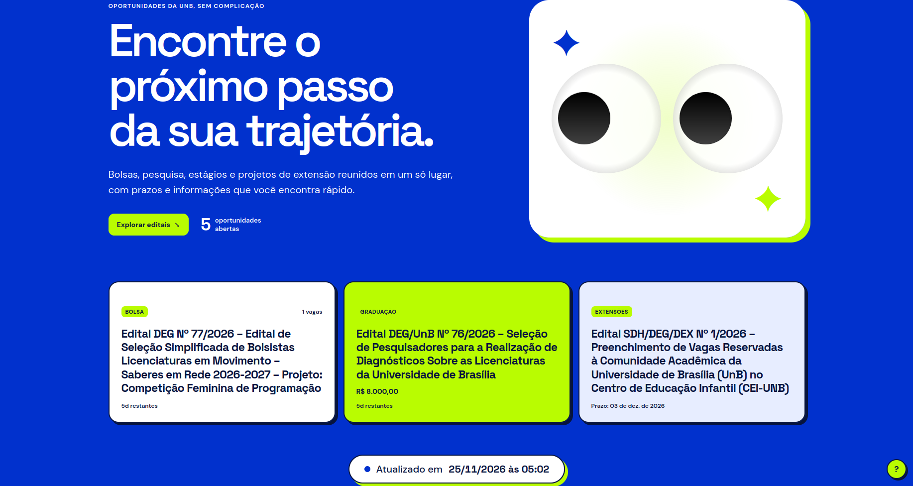

<div align="center">


# Fique de Olho — Editais UnB

**Bolsas, pesquisa, estágios e projetos de extensão da UnB reunidos em um só lugar,**
**com prazos e informações que você encontra rápido.**

<p>
  <a href="https://github.com/unb-mds/G4-2026-2/actions/workflows/pipeline.yml"></a>
  <a href="https://github.com/unb-mds/G4-2026-2/actions/workflows/deploy-docs.yml"></a>
  <a href="https://github.com/unb-mds/G4-2026-2/actions/workflows/sync-editais.yml"></a>
  <a href="https://fique-de-olho.vercel.app"></a>
  <a href="https://fique-de-olho-api.onrender.com/docs"></a>
</p>

<p>
  
  
  
  
  
  
  
</p>

[**Acessar o site**](https://fique-de-olho.vercel.app) ·
[**API (Swagger)**](https://fique-de-olho-api.onrender.com/docs) ·
[**Documentação**](https://unb-mds.github.io/G4-2026-2/) ·
[**Rodar localmente**](#-como-executar-localmente)

<br />



</div>

---

## 📌 Sumário

- [O problema e a solução](#-o-problema-e-a-solução)
- [Funcionalidades](#-funcionalidades)
- [Acesso rápido e ambientes](#-acesso-rápido-e-ambientes)
- [Como executar localmente](#-como-executar-localmente)
- [Arquitetura](#-arquitetura)
- [Documentação técnica](#-documentação-técnica)
- [Qualidade e testes](#-qualidade-e-testes)
- [Equipe](#-equipe)

---

## 🎯 O problema e a solução

Editais da UnB ficam espalhados em dezenas de páginas institucionais, PDFs extensos e links do SEI. Estudantes precisam consultar várias fontes, interpretar cronogramas e conferir retificações para não perder prazos de bolsas, estágios, intercâmbios, monitorias e processos seletivos.

O **Fique de Olho** centraliza, estrutura e filtra esses editais, e avisa a comunidade universitária antes que o prazo termine.

> Projeto do grupo **G4** da disciplina de **Métodos de Desenvolvimento de Software** (UnB, 2026/2).

---

## ✨ Funcionalidades

| | Funcionalidade | O que faz |
| :-: | :--- | :--- |
| 🔎 | **Coleta automatizada** | Busca editais em **33 portais da UnB** (DEG, DPG, INT, DEX, DPI, DAC, SIGAA, Cebraspe, FINATEC, FUP, HUB, Ocean, entre outros), duas vezes ao dia via GitHub Actions. |
| 📄 | **Leitura inteligente de PDFs** | Extração local (**Camada 1**, `pdfplumber` + regex) com apoio opcional de IA (**Camada 2**, Google Gemini `3.5-flash-lite`) para padronizar títulos, resumos, prazos, vagas e valores de bolsa. |
| 🧭 | **Busca e filtros** | Filtros combináveis por situação (`aberto`/`fechado`), **campus** (com aliases como `FGA`/`Gama`, `FUP`/`Planaltina`, `FCE`/`Ceilândia`), **ano**, 9 categorias (`Graduação`, `Pós-graduação`, `Intercâmbio`, `Bolsa`, `Pesquisa`, `Estágio`, `Extensão`, `Evento`, `Vestibular`) e busca textual, com cache Stale-While-Revalidate. |
| 🕒 | **Selo de atualização** | Mostra na página inicial quando o catálogo foi atualizado pela última vez (horário de Brasília). |
| 🔐 | **Contas** | Login com e-mail e senha (Argon2 + JWT) ou **Google OAuth2**. |
| ⭐ | **Favoritos** | Lista pessoal de editais para acompanhar. |
| 🔔 | **Alertas por e-mail** | Ativação explícita por edital, com avisos 3 dias, 1 dia e no dia do encerramento (UTC-3), via **SendGrid**. |
| 💬 | **Central de Ajuda** | Botão `?` com formulário de feedback encaminhado para a equipe. |

---

## 🚀 Acesso rápido e ambientes

| Serviço | Plataforma | Link | Descrição |
| :--- | :---: | :--- | :--- |
| **Aplicação Web** | Vercel | [fique-de-olho.vercel.app](https://fique-de-olho.vercel.app) | Interface React 18 + TypeScript + Vite |
| **API REST e Swagger** | Render | [fique-de-olho-api.onrender.com/docs](https://fique-de-olho-api.onrender.com/docs) | Documentação interativa OpenAPI (FastAPI) |
| **Healthcheck** | Render | [fique-de-olho-api.onrender.com/health](https://fique-de-olho-api.onrender.com/health) | Status da API, do banco PostgreSQL e do SendGrid |
| **Keep-Alive** | Render | [fique-de-olho-api.onrender.com/ping](https://fique-de-olho-api.onrender.com/ping) | Sonda leve, sem acesso ao banco |
| **Banco de dados** | Neon | AWS São Paulo (`sa-east-1`) | PostgreSQL 16 Serverless (14 tabelas via Alembic) |
| **Documentação técnica** | GitHub Pages | [unb-mds.github.io/G4-2026-2](https://unb-mds.github.io/G4-2026-2/) | Portal MkDocs Material |

---

## ⚡ Como executar localmente

### Pré-requisitos

| Modo | Precisa de |
| :--- | :--- |
| **Docker Compose** (recomendado) | Git, Docker e Docker Compose v2 |
| **Sem container** | Python 3.12+, Node.js 18+ e PostgreSQL 16 |

### Opção A — Tudo com Docker Compose (recomendado)

Na **raiz do repositório**, o `docker-compose.yml` sobe os 3 serviços (**Frontend**, **API** e **PostgreSQL**) e já roda `alembic upgrade head`:

```bash
docker compose up --build -d
docker compose ps
```

| Serviço | Endereço |
| :--- | :--- |
| Frontend | http://localhost:5173 |
| API | http://localhost:8000 |
| Swagger | http://localhost:8000/docs |
| Health | http://localhost:8000/health |
| PostgreSQL | `localhost:5432` |

> [!TIP]
> **Porta 5432 ocupada** (por exemplo, por um PostgreSQL instalado na máquina)? Crie um `.env` na raiz com outra porta e suba de novo:
> ```bash
> echo "POSTGRES_PORT=55432" > .env
> docker compose up -d
> ```

Comandos úteis:

```bash
docker compose logs -f api db     # logs da API e do banco
docker compose restart api        # reiniciar a API após mudar o Back/.env
docker compose down               # parar, mantendo os dados do banco
docker compose down -v            # parar e apagar o banco local
```

### Opção B — Backend e Frontend fora do Docker (só o banco no Docker)

```bash
# 1) Banco de dados (na raiz)
docker compose up -d db

# 2) Backend (terminal 1)
cd Back
python3 -m venv .venv
source .venv/bin/activate
pip install -r requirements.txt
cp .env.example .env
alembic upgrade head
uvicorn app.main:app --reload --port 8000

# 3) Frontend (terminal 2)
cd Front
npm ci
npm run dev
```

<details>
<summary><b>Usa Windows (PowerShell)?</b></summary>

```powershell
cd Back
python -m venv .venv
.\.venv\Scripts\Activate.ps1
pip install -r requirements.txt
Copy-Item .env.example .env
alembic upgrade head
uvicorn app.main:app --reload --port 8000
```

</details>

### Popular o banco com editais reais

Com o banco vazio, o site não tem o que mostrar. Dispare uma coleta pela API:

```bash
# teste rápido: só o portal DEG, 5 editais
curl -X POST "http://localhost:8000/api/v1/editais/sync?orgao=DEG&max_itens=5"

# coleta completa em todos os portais (pode levar vários minutos)
curl --max-time 3600 -X POST "http://localhost:8000/api/v1/editais/sync?max_itens=30"
```

Depois recarregue o site. O selo "Atualizado em" passa a mostrar o horário da coleta. Em desenvolvimento, o agendador automático só roda a cada 12 horas; para mudar isso, veja `SCRAPER_SCHEDULER_RUN_ON_STARTUP` no `docker-compose.yml`.

> [!NOTE]
> **Variáveis opcionais no `Back/.env`:** `GEMINI_API_KEY` (resumos com IA, com `GEMINI_MODEL=gemini-3.5-flash-lite` e `GEMINI_FALLBACK_MODEL=gemini-flash-lite-latest`), `SENDGRID_API_KEY` (alertas por e-mail) e `GOOGLE_CLIENT_ID`/`GOOGLE_CLIENT_SECRET` (login com Google). Sem elas o sistema sobe normalmente, só essas funções ficam desativadas.

### Ver a documentação (MkDocs) localmente

```bash
# porta 8001 para não conflitar com a API na 8000
mkdocs serve -a 127.0.0.1:8001
```

---

## 🏗️ Arquitetura

```text
Front (React 18 + TypeScript + Vite) ──────────────► Vercel
                  │ HTTP / JSON (Bearer JWT)
Back (FastAPI + SQLAlchemy + Alembic) ─────────────► Render (Docker)
   ├── modules/editais      (filtros SQL + cache SWR)
   ├── modules/usuarios     (Argon2 + JWT + Google OAuth2)
   ├── modules/favoritos    (lista pessoal)
   ├── modules/feedback     (formulário -> tabela feedbacks + e-mail SendGrid)
   ├── modules/notificacoes (alertas_edital + SendGrid)
   └── modules/scraper      (33 portais + pdfplumber + Gemini 3.5 Flash-Lite)
                  │
PostgreSQL 16 (14 tabelas) ────────────────────────► Neon Serverless
```

As decisões de arquitetura estão registradas em ADRs:

| ADR | Tema |
| :-: | :--- |
| [0001](docs/adr/0001-stack-backend.md) | Stack do Backend |
| [0002](docs/adr/0002-stack-frontend.md) | Stack do Frontend |
| [0003](docs/adr/0003-database-schema.md) | Schema inicial do banco de dados |
| [0004](docs/adr/0004-plataformas-de-deploy.md) | Plataformas de hospedagem e deploy |
| [0005](docs/adr/0005-enriquecimento-hibrido-camada1-gemini.md) | Pipeline híbrido (Camada 1 + Gemini) |
| [0006](docs/adr/0006-evolucao-schema-catalogos-alertas-notificacoes.md) | Evolução do schema, alertas e notificações |

---

## 📚 Documentação técnica

**Backend, API e banco de dados**

- [Visão geral e Quickstart do Backend](docs/backend/index.md)
- [Referência da API REST (19 endpoints, auth, filtros, feedback e exemplos)](docs/backend/api.md)
- [Banco de dados e migrations (diagrama ER, 14 tabelas e Alembic)](docs/backend/banco-de-dados.md)
- [Pipeline de coleta, PDF e IA (33 portais, Camada 1 + Gemini e backfill)](docs/backend/coleta-e-ia.md)
- [Operação, notificações e deploy (SendGrid, Render/Neon, testes e troubleshooting)](docs/backend/operacao-e-deploy.md)

**Arquitetura, domínio e produto**

- [Glossário de domínio (`CONTEXT.md`)](CONTEXT.md)
- [Arquitetura do sistema](docs/Arquitetura.md)
- [Frontend](docs/front.md)
- [Requisitos, personas e backlog](docs/Requisitos/)
- [Board de planejamento (Figma)](https://www.figma.com/board/Sw1R44AAXzZrW5eBolJybw/Template-MDS--c%C3%B3pia-limpa---c%C3%B3pia-?node-id=1-291) · [Protótipo de alta fidelidade](https://www.figma.com/make/yqHT0b3mk0T3EkHD2aUgns/UnB-Editais-Aggregator-Site?fullscreen=1)

---

## 🧪 Qualidade e testes

```bash
# Backend (unitários e integração, sem chamadas externas)
cd Back && python -m pytest tests -m "not live"

# Frontend
cd Front
npm test
npm run lint
npm run build

# Backfill local de títulos, resumos e datas (dry-run)
docker exec fique-de-olho-api python -m app.modules.scraper.backfill_titles_summaries --limit 5 --sleep 2.0
```

O CI ([`pipeline.yml`](.github/workflows/pipeline.yml)) roda a cada push e pull request nas branches `main` e `Dev`. Problemas comuns (portas `5432`/`8000` ocupadas, `.env` no Docker, erros `404`/`429`/`503` do Gemini) estão no [Guia de Troubleshooting](docs/backend/operacao-e-deploy.md#troubleshooting).

---

## 👥 Equipe

| Nome | Matrícula |
| :--- | :---: |
| Arthur Amaral da Silva | `24200514` |
| Eduardo Henrique Coutinho Gurjão | `222006679` |
| Felippe Ong Su | `242028664` |
| Isac Silva Marques | `242023846` |
| Ryan Kelvyn Fernandes de Carvalho | `241025560` |
| Wendell Derick Mathias Santana dos Santos | `241025739` |

<div align="center">

<sub>Feito na Universidade de Brasília · Métodos de Desenvolvimento de Software · 2026/2</sub>

</div>