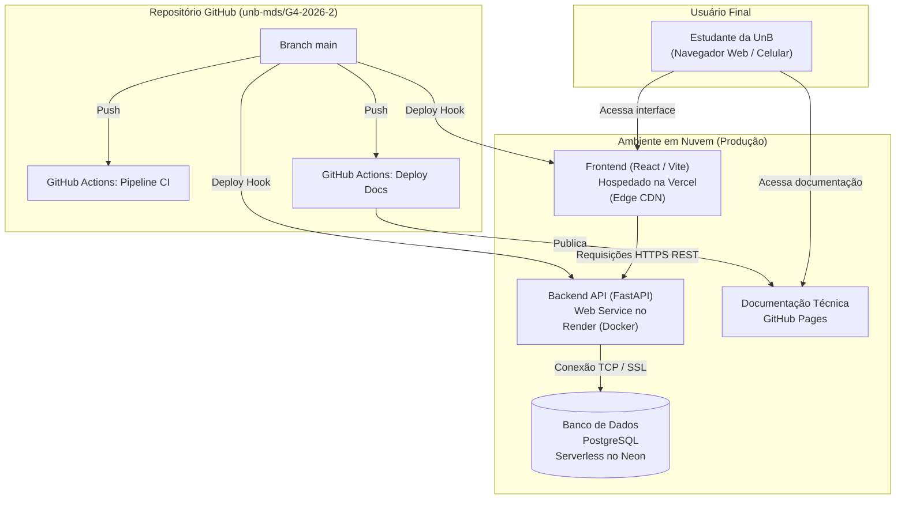

# Arquitetura do Fique de Olho

Este documento descreve a arquitetura implementada e planejada no repositório do **Fique de Olho**. As funcionalidades que aparecem nos requisitos ou nas decisões, mas ainda não estão conectadas ao fluxo da aplicação, são identificadas como planejadas ou ainda não implementadas.

---

## Stack de tecnologias

### Frontend

- **React 18** e **React DOM** para construir a interface web reativa.
- **TypeScript** para tipagem estática e segurança nos contratos de dados.
- **Vite** para desenvolvimento e build otimizado.
- **React Router** para navegação e roteamento no cliente (*client-side routing*).
- **Fetch API** para comunicação HTTP com o backend.
- **Vercel** para hospedagem e deploy contínuo da aplicação web (conforme [ADR 0004](adr/0004-plataformas-de-deploy.md)).

### Backend

- **Python 3.12+** como linguagem principal.
- **FastAPI** para a API REST assíncrona e documentação OpenAPI.
- **Uvicorn** como servidor ASGI de alta performance.
- **Pydantic Settings** para validação e configuração por variáveis de ambiente.
- **SQLAlchemy** como ORM e camada de acesso ao banco.
- **Alembic** para versionamento e migrações do schema de dados.
- **psycopg2** como driver PostgreSQL.
- **HTTPX** e **BeautifulSoup** para requisições HTTP e parsing HTML das listagens de editais.
- **pdfplumber** para extração de texto estruturado de documentos em PDF.
- **Docker** e **Docker Compose** para containerização do ambiente.
- **Render** para execução do container da API na nuvem com HTTPS automático (conforme [ADR 0004](adr/0004-plataformas-de-deploy.md)).

### Banco de dados

- **PostgreSQL 16** como banco de dados relacional.
- **Neon / Supabase** como provedor de banco de dados em nuvem para homologação e produção (conforme [ADR 0004](adr/0004-plataformas-de-deploy.md)).
- **Docker Compose** com volume persistente para execução local de desenvolvimento.

### Documentação Técnica

- **MkDocs Material** para geração do portal estático de documentação.
- **GitHub Pages** para publicação automatizada através do GitHub Actions ([`.github/workflows/deploy-docs.yml`](../.github/workflows/deploy-docs.yml)).

---

## Componentes

### Frontend

O frontend em `Front/` usa React, TypeScript, Vite e React Router.

- `Front/src/pages/`: contém as páginas inicial (`HomePage`) e de detalhes do edital (`EditalDetailPage`).
- `Front/src/components/`: reúne os elementos de interface reutilizáveis (cards, cabeçalho, filtros e lista de favoritos).
- `Front/src/services/`: centraliza as chamadas HTTP à API (`editaisService.ts`) e os tipos consumidos pela interface.
- `Front/src/routes/AppRoutes.tsx`: define as rotas navegáveis da aplicação (`/` e `/editais/:id`).

A página inicial busca a lista de editais e filtra a categoria no navegador. A página de detalhes busca um edital pelo identificador. A URL da API é parametrizada via variável de ambiente `VITE_API_BASE_URL`.

### API e módulos de negócio

O backend em `Back/app/` usa FastAPI, Pydantic, SQLAlchemy e PostgreSQL.

- `Back/app/main.py`: cria a aplicação, configura CORS, expõe o healthcheck e registra as rotas.
- `Back/app/core/`: fornece configurações de ambiente (`config.py`), conexão e sessões de banco de dados (`database.py`).
- `Back/app/modules/editais/`: implementa as rotas, schemas, modelos e consultas de editais.
- `Back/app/modules/scraper/`: acessa o portal do DEG e outras fontes da UnB, interpreta as listagens e coordena a persistência dos novos registros.

O módulo de editais oferece listagem com filtros por status, categoria, campus e busca textual, além de consulta por ID. 

As rotas principais estão disponíveis sob `/api/v1`. O backend também registra as mesmas rotas sem esse prefixo, sem incluí-las no schema OpenAPI, para compatibilidade com chamadas legadas.

### Banco de dados

O PostgreSQL armazena os editais e seus relacionamentos com catálogos de tipos, campi e documentos anexos. O schema também define tabelas para usuários e favoritos.

O schema é gerenciado pelo Alembic a partir das definições em `Back/app/core/database.py`, garantindo rastreabilidade e consistência entre os ambientes locais e de nuvem.

---

## Diagramas C4

Os espaços abaixo consolidam os diagramas C4 deste projeto.

### Diagrama de Contexto (C4 — Nível 1)

### Diagrama de Contêineres (C4 — Nível 2)

---

## Fluxos principais

### Consulta de editais

1. O frontend chama a API pelo serviço em `Front/src/services/editaisService.ts`.
2. A rota FastAPI valida os parâmetros e delega a consulta ao serviço do módulo de editais.
3. O serviço consulta o PostgreSQL com SQLAlchemy, aplica os filtros e serializa os registros para os schemas de resposta Pydantic.
4. O frontend apresenta a listagem ou os detalhes recebidos na interface.

### Coleta dos portais

1. Uma chamada `POST /api/v1/editais/sync` solicita a sincronização; a rota aceita um limite de itens.
2. O serviço de coleta registra uma execução em `coletas` e solicita a listagem ao portal institucional da UnB.
3. O scraper extrai título, endereço e data de publicação do HTML. A categoria é inferida pelo título.
4. O serviço evita inserir novamente um edital cujo endereço já esteja cadastrado, persiste novos registros e atualiza o resultado da coleta.

Essa coleta é acionada sob demanda pela API. O scraper também possui funções para encontrar links de PDFs e classificá-los, preparando a ingestão contínua.

---

## Arquitetura de Deploy e Infraestrutura em Nuvem

Conforme definido na [ADR 0004](adr/0004-plataformas-de-deploy.md), o sistema adota uma infraestrutura desacoplada com implantação contínua (CD):

---

## Execução Local (Desenvolvimento)

Para o ambiente de desenvolvimento local na máquina dos contribuidores, o projeto continua suportando execução unificada:

1. **Docker Compose:**
   - `docker compose up --build -d` inicia a API FastAPI na porta `8000` e o PostgreSQL na porta `5432`.
2. **Frontend Local:**
   - `npm run dev` na pasta `Front/` executa a aplicação na porta `5173`, apontando para `http://localhost:8000`.

---

## Referências de implementação

- `Back/README.md` — instruções e detalhes do backend.
- `Front/README.md` — instruções e detalhes do frontend.
- [Estudo de Plataformas de Deploy](Estudos/estudo_plataformas_deploy.md)
- [ADR 0001 - Stack do Backend](adr/0001-stack-backend.md)
- [ADR 0002 - Stack do Frontend](adr/0002-stack-frontend.md)
- [ADR 0003 - Schema do Banco de Dados](adr/0003-database-schema.md)
- [ADR 0004 - Plataformas de Hospedagem e Deploy](adr/0004-plataformas-de-deploy.md)

