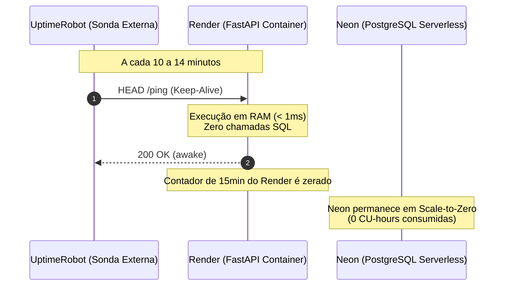

# Guia Técnico: Estratégia de Keep-Alive 24/7 com UptimeRobot e Endpoint `/ping`

Este documento detalha a estratégia de engenharia de infraestrutura adotada no projeto **Fique de Olho** para eliminar os atrasos de inicialização a frio (*cold starts*) do backend em nuvem sem custos financeiros e sem esgotar as cotas gratuitas do banco de dados relacional.

---

## 1. Contexto e o Problema dos *Cold Starts*

A plataforma utiliza duas soluções de nuvem em camadas gratuitas (*Free Tier*):
1. **Render (Web Services):** Hospeda a API FastAPI em container Docker.
2. **Neon (Serverless PostgreSQL):** Armazena os dados estruturados de editais e usuários.

Ambas as plataformas aplicam políticas automáticas de suspensão por inatividade para economizar recursos:

* **Spin-down do Render (15 minutos):** Se a aplicação web não receber requisições HTTP por 15 minutos consecutivos, o Render desliga o container. Ao receber uma nova requisição, o Render leva de **40 a 60 segundos** para reconstruir o ambiente e subir o servidor (*cold start*).
* **Scale-to-zero do Neon (5 minutos):** Se nenhuma consulta SQL for executada por 5 minutos, a máquina virtual de computação do banco de dados desliga. Ao chegar uma consulta, o Neon leva de **3 a 5 segundos** para reativar.

> **Impacto no Usuário:** Sem uma estratégia de aquecimento, um usuário que acessa o site após um período de inatividade enfrenta uma espera cumulativa de quase **1 minuto** até que o container suba e o banco responda.

---

## 2. A Armadilha do Healthcheck Tradicional (`/health`)

A primeira ideia intuitiva para manter o container ativo seria configurar uma ferramenta externa para chamar periodicamente o endpoint de integridade já existente na aplicação: `GET /health`.

No entanto, uma análise detalhada do código revelou uma **grave armadilha de custos e disponibilidade**:

```python
@app.get("/health", tags=["Health"])
def health_check():
    """Endpoint de verificação de integridade e banco de dados."""
    db_status = "connected"
    try:
        with engine.connect() as conn:
            conn.execute(text("SELECT 1"))
    except Exception as e:
        db_status = f"disconnected: {e}"
    ...
```

### Por que usar o `/health` causaria o colapso do banco de dados?
1. **Esgotamento da Cota do Neon:**
   - O plano gratuito do Neon concede **100 Compute Unit-hours (CU-horas) por mês**.
   - Se um monitor externo chamar o `/health` a cada 10 minutos, o comando `SELECT 1` acordará o banco continuamente.
   - Como o Neon leva 5 minutos para suspender após cada comando, o banco **nunca desligaria**, consumindo computação 24 horas por dia (cerca de **720 horas/mês**).
   - **Resultado:** A cota mensal de 100 horas do Neon seria **completamente esgotada em apenas 4 a 5 dias**, bloqueando o acesso de leitura e escrita da aplicação.

2. **Loop de Reinicialização Infinita no Render (*CrashLoop*):**
   - No [render.yaml](../../render.yaml), o Render monitora a saúde da aplicação pelo `healthCheckPath`.
   - Se o banco estiver suspenso ou com a cota esgotada, o `/health` falha na conexão e responde `HTTP 503 Service Unavailable`.
   - Pela política do Render, se um container falhar em checagens consecutivas por 60 segundos, ele é **automaticamente reiniciado**.
   - O container entraria em loop infinito de reinicializações, impedindo até mesmo que a API servisse dados em cache de memória.

---

## 3. A Solução Arquitetural: Endpoint Ultraleve `/ping`

Para resolver essa equação, desacoplamos a saúde do servidor web da conectividade do banco de dados, criando o endpoint `GET /ping` no [`Back/app/main.py`](../../Back/app/main.py):

```python
@app.api_route("/ping", methods=["GET", "HEAD"], tags=["Health"])
def ping():
    """Endpoint leve de keep-alive que mantém o contêiner acordado sem consultar o banco."""
    return {"status": "awake"}
```

### Características Técnicas do `/ping`:
* **Zero I/O de Banco de Dados:** Não injeta `Session`, não abre conexões pelo SQLAlchemy e não emite queries SQL.
* **Execução em Memória (< 1ms):** Responde instantaneamente direto da memória RAM.
* **Suporte Nativo a `GET` e `HEAD` (RFC 7231):** O método `HEAD` requisita apenas os cabeçalhos sem o corpo da mensagem. Isso garante compatibilidade total com planos gratuitos de monitoramento.

---

## 4. Integração com o UptimeRobot

O **[UptimeRobot](https://uptimerobot.com/)** é utilizado como o agente externo gratuito encarregado de "acordar" o Render periodicamente.

### Por que o UptimeRobot?
* Plano gratuito vitalício permitindo até 50 monitores.
* Intervalos de checagem configuráveis a cada 5 a 14 minutos (ideal para neutralizar o limite de 15 minutos de inatividade do Render).

### Funcionamento das Requisições:


### Passo a Passo de Configuração no UptimeRobot:
1. Acesse o painel do [UptimeRobot](https://uptimerobot.com/) e clique em **+ Add New Monitor**.
2. **Monitor Type:** Selecione `HTTP(s)`.
3. **Friendly Name:** Digite `Fique de Olho - Render Keep-Alive`.
4. **URL (or IP):** Insira `https://fique-de-olho-api.onrender.com/ping`.
5. **Monitoring Interval:** Escolha `10 minutes` ou `14 minutes` (deve ser menor que 15 minutos).
6. Clique em **Create Monitor**.

> **Nota sobre o método `HEAD`:** No plano gratuito do UptimeRobot, o método de envio padrão é `HEAD`. O backend da aplicação foi ajustado para aceitar tanto `HEAD` quanto `GET`, eliminando o erro `405 Method Not Allowed` sem exigir assinatura do plano Pro.

---

## 5. Alinhamento com a Infraestrutura como Código (`render.yaml`)

Para que o orquestrador do próprio Render também não sobrecarregue o banco de dados durante os deploys e sondas internas de vida (*liveness probes*), atualizamos o arquivo de configuração declarativa [`render.yaml`](../../render.yaml):

```yaml
services:
  - type: web
    name: fique-de-olho-api
    runtime: docker
    region: ohio
    plan: free
    rootDir: Back
    dockerfilePath: Dockerfile
    healthCheckPath: /ping  # <-- Aponta para o endpoint sem banco
```

Com essa alteração:
1. O Render valida que o servidor ASGI/Uvicorn subiu com sucesso checando `/ping`.
2. Em caso de instabilidade ou lentidão temporária do banco, o container web não é derrubado nem reiniciado em loop.

---

## 6. Balanço Geral de Recursos e Cotas

| Recurso | Sem a Solução (Cenário Antigo) | Com a Solução (`/ping` + UptimeRobot) |
| :--- | :---: | :---: |
| **Tempo de Resposta Inicial** | ~45s a 60s (*Cold Start*) | **< 1 segundo** (Container sempre ativo) |
| **Horas do Render Web** | Variável (~200h) | ~720h/mês (**Totalmente coberto** pelas 750h gratuitas) |
| **Horas de Computação Neon** | ~720h/mês (**Estouro de cota** em 4 dias) | **~15h a 30h/mês** (Apenas acessos e consultas reais) |
| **Custo Mensal** | R$ 0,00 (porém com queda por cota) | **R$ 0,00 real e perene** |
