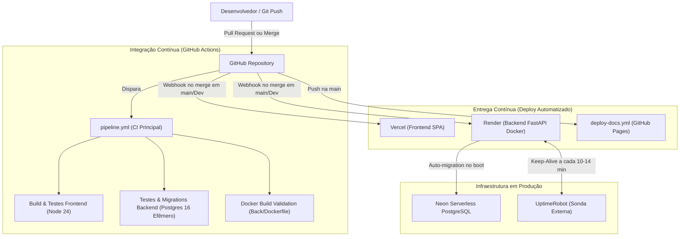

# Guia Operacional de Deploy: CI/CD, Rollback e Schedulers em Background

Este documento consolida as práticas operacionais de engenharia de software da plataforma **Fique de Olho**, detalhando:
1. O funcionamento da esteira automatizada de **Integração e Entrega Contínua (CI/CD)**;
2. Os procedimentos operacionais de **Rollback e Recuperação de Desastres** (*Disaster Recovery*);
3. A arquitetura de execução dos **Agendadores em Segundo Plano (*Schedulers*)** dentro do container unificado da API.

---

## 1. Visão Geral da Arquitetura de Entrega

A esteira de entrega do projeto é 100% automatizada e desacoplada em três provedores especializados de nuvem, todos integrados ao repositório GitHub através de automações e webhooks de eventos:



---

## 2. Esteira Automatizada de CI/CD

### 2.1. Pipeline de Integração Contínua (CI)
O arquivo de workflow [`.github/workflows/pipeline.yml`](../../.github/workflows/pipeline.yml) atua como a barreira de qualidade automatizada executada a cada *Push* ou *Pull Request* direcionado às branches `main` e `Dev`. O pipeline é composto por três jobs paralelos e sequenciais:

#### 1. `build-frontend` (Build e Testes do Frontend)
* **Ambiente:** `ubuntu-latest` com **Node.js 24** e cache de dependências do `npm`.
* **Etapas:**
  1. `npm ci`: Instalação determinística de dependências a partir do `package-lock.json`.
  2. `npm run test`: Execução da suíte de testes unitários em componentes React (Vitest/Jest).
  3. `npm run build`: Validação estrita de tipagem TypeScript e geração dos artefatos estáticos de produção na pasta `dist/`.

#### 2. `test-backend` (Testes com Banco Real Efêmero)
* **Serviço de Apoio:** Sobe um container de serviço `postgres:16-alpine` na porta 5432 do runner com *health-cmd* (`pg_isready`), isolando completamente os testes de qualquer banco externo de produção.
* **Ambiente:** Python 3.12 com cache de pacotes via `pip`.
* **Etapas:**
  1. Instalação das dependências do [`Back/requirements.txt`](../../Back/requirements.txt).
  2. `alembic upgrade head`: Aplicação das migrações do Alembic sobre o PostgreSQL efêmero para validar que o schema e as revisões SQL estão 100% íntegros.
  3. **Seeds de Banco:** População de dados iniciais de catálogo e editais de teste para permitir cenários realistas de filtro e busca.
  4. `pytest tests -v`: Execução de toda a suíte de testes unitários e de integração do backend.

#### 3. `build-backend` (Compilação do Container)
* **Condição:** Depende do sucesso do job `test-backend` (`needs: test-backend`).
* **Objetivo:** Executa `docker build --tag fique-de-olho-backend:ci ./Back` para certificar que o [`Back/Dockerfile`](../../Back/Dockerfile) compila com sucesso, garantindo que nenhum erro de empacotamento de sistema operacional chegue ao ambiente de deploy.

---

### 2.2. Pipeline de Entrega Contínua (CD)

O deploy é ativado de forma passiva através de gatilhos automáticos nos serviços em nuvem:

| Camada | Provedor | Gatilho de Deploy | Processo de Implantação |
|---|---|---|---|
| **Frontend** | **Vercel** | Webhook no merge da branch de produção | Executa o build Vite, publica na CDN global e aplica as regras de *rewrite* do [`Front/vercel.json`](../../Front/vercel.json) para roteamento SPA sem erro 404 em rotas internas. |
| **Backend** | **Render** | Webhook no merge da branch de produção | Baixa o código, compila a imagem Docker, executa as migrações automáticas (`alembic upgrade head`) no boot do container e avalia o endpoint `/ping` via zero-downtime deploy. |
| **Docs** | **GitHub Pages** | Push na branch `main` via [`.github/workflows/deploy-docs.yml`](../../.github/workflows/deploy-docs.yml) | Executa o `mkdocs gh-deploy` e atualiza a documentação estática online na branch `gh-pages`. |

---

## 3. Procedimentos de Rollback e Recuperação de Desastres (*Disaster Recovery*)

Caso um deploy defeituoso ou uma quebra de regressão atinja o ambiente de homologação ou produção, a equipe deve seguir os procedimentos de contingência abaixo:

### 3.1. Rollback do Backend no Render
O Render mantém o histórico de imagens e deploys compilados anteriormente, permitindo restaurar uma versão estável em menos de 1 minuto sem necessidade de novos commits:

1. Acesse o painel do [Render Dashboard](https://dashboard.render.com/).
2. Clique no serviço **`fique-de-olho-api`**.
3. Na barra lateral esquerda, acesse a aba **Events** (ou **Deploys**).
4. Localize o último deploy que estava saudável (com status verde *Live* anterior).
5. Clique no menu de opções (`...`) ao lado do deploy e selecione **Rollback to this deploy**.
6. O Render redirecionará o tráfego imediatamente para a versão funcional anterior.

---

### 3.2. Rollback do Frontend na Vercel
A Vercel mantém todos os builds históricos ativos sob hashes imutáveis (*Instant Rollback*):

1. Acesse o painel da [Vercel](https://vercel.com/dashboard) e entre no projeto **`fique-de-olho`**.
2. Clique na aba **Deployments**.
3. Encontre o deployment anterior que estava estável.
4. Clique no ícone de três pontos (`...`) no canto direito do card de deployment.
5. Clique em **Promote to Production**.
6. Em menos de 5 segundos, a Edge CDN global da Vercel passa a entregar a versão estável aos usuários.

---

### 3.3. Reversão de Banco de Dados e Migrações (Alembic & Neon)

#### Cenário A: Reversão de Schema (Bug em Migração Recente)
Se uma migração recém-aplicada gerou incompatibilidade de colunas ou índices:
1. Conecte-se ao banco de dados utilizando a CLI do Alembic ou um terminal com a variável `DATABASE_URL`:
   ```bash
   cd Back
   # Reverte exatamente 1 revisão de migração
   alembic downgrade -1
   
   # Ou reverte para um ID de revisão específico
   alembic downgrade <revision_id>
   ```
2. Todas as migrações em [`Back/migrations/versions/`](../../Back/migrations/versions/) possuem métodos `downgrade()` implementados com exclusão segura de tabelas, constraints e enums.

#### Cenário B: Recuperação de Dados Corrompidos no Neon (PITR & Branching)
Se ocorrer exclusão acidental de dados ou inconsistência grave em produção:
* **Point-in-Time Restore (PITR):** O Neon mantém o histórico contínuo de log de transações (*Write-Ahead Log*). No painel do Neon, é possível restaurar o banco para o exato minuto anterior ao incidente.
* **Database Branching:** O Neon permite criar uma *Branch* do banco baseada em um timestamp do passado. A equipe pode inspecionar os dados recuperados de forma isolada antes de restaurá-los na branch principal (*main branch* do Neon), garantindo zero tempo de parada.

---

## 4. Arquitetura dos Agendadores em Background (*Schedulers*)

### 4.1. O Trade-off Arquitetural: Worker Separado vs. Container Unificado

Em arquiteturas tradicionais de nuvem corporativa, agendadores de tarefas em segundo plano (*background workers*) costumam rodar em instâncias dedicadas (como instâncias separadas de Celery, Redis Queue ou Cron Jobs gerenciados).

* **A restrição do PaaS gratuito:** No Render, instâncias dedicadas do tipo *Background Worker* são permitidas apenas em planos pagos (a partir de US$ 7,00 mensais por container).
* **A solução arquitetural da equipe:** Unificar as rotinas periódicas de scraping e notificações assíncronas dentro do mesmo processo da API FastAPI através do manipulador de ciclo de vida nativo [`@asynccontextmanager lifespan(app: FastAPI)`](../../Back/app/main.py).

---

### 4.2. Funcionamento Interno no FastAPI (`lifespan`)

Ao iniciar o container, o FastAPI inicializa duas tarefas assíncronas em segundo plano via `asyncio.create_task`:

```python
@asynccontextmanager
async def lifespan(_app: FastAPI):
    background_tasks = []
    
    # 1. Agendador de Notificações por E-mail (SendGrid)
    if settings.NOTIFICATION_SCHEDULER_ENABLED:
        background_tasks.append(
            asyncio.create_task(
                executar_scheduler_notificacoes(
                    settings.NOTIFICATION_SCHEDULER_INTERVAL_SECONDS
                )
            )
        )
        
    # 2. Agendador Periódico de Coleta de Editais (Scraper)
    if settings.SCRAPER_SCHEDULER_ENABLED:
        background_tasks.append(
            asyncio.create_task(
                executar_scheduler_scraper(
                    settings.SCRAPER_SCHEDULER_INTERVAL_HOURS * 3600,
                    run_on_startup=settings.SCRAPER_SCHEDULER_RUN_ON_STARTUP,
                )
            )
        )
    try:
        yield
    finally:
        # Graceful shutdown ao receber SIGTERM do Render
        for task in background_tasks:
            task.cancel()
        if background_tasks:
            await asyncio.gather(*background_tasks, return_exceptions=True)
```

### 4.3. Detalhamento dos Agendadores

| Agendador | Módulo | Frequência Padrão | Responsabilidade |
|---|---|---|---|
| **Scraper Scheduler** | [`Back/app/modules/scraper/scheduler.py`](../../Back/app/modules/scraper/scheduler.py) | A cada **12 horas** (`SCRAPER_SCHEDULER_INTERVAL_HOURS=12`) | Executa a varredura automatizada nos portais públicos da UnB (DEG, BCE, etc.), faz download e extração de metadados de novos editais em PDF, persiste no banco e invalida o cache SWR. |
| **Notification Scheduler** | [`Back/app/modules/notificacoes/scheduler.py`](../../Back/app/modules/notificacoes/scheduler.py) | A cada **1 hora** (`NOTIFICATION_SCHEDULER_INTERVAL_SECONDS=3600`) | Consulta novos editais cadastrados e cruza com as preferências de palavras-chave e categorias dos usuários cadastrados, disparando e-mails em lote através do Twilio SendGrid. |

---

### 4.4. A Simbiose com a Estratégia de Keep-Alive (UptimeRobot)

Existe uma interdependência técnica fundamental entre os **Schedulers em Background** e o **Monitoramento Keep-Alive**:

> ⚠️ **O Risco sem o Keep-Alive:** Se o Render hibernasse após 15 minutos sem tráfego, as tarefas em segundo plano (`asyncio.create_task`) seriam **congeladas junto com o processo do container**. Os scrapers e os e-mails de alerta não seriam executados nos horários programados.

> 💡 **A Solução com o UptimeRobot:** Como o UptimeRobot dispara requisições periódicas a cada 10–14 minutos no endpoint `/ping`, o container web do Render **permanece continuamente acordado (24/7)**. Como consequência, o relógio interno do `asyncio` nunca é interrompido, garantindo que a coleta de editais a cada 12 horas e o envio de alertas por e-mail a cada 1 hora aconteçam com **precisão pontual e custo R$ 0,00 de computação**.

---

## 5. Resumo das Variáveis de Configuração dos Agendadores

Para ajustar o comportamento dos agendadores em produção, as seguintes variáveis podem ser configuradas no painel do Render ou arquivo [`.env`](../../Back/.env.example):

```bash
# Habilita ou desabilita o disparo de e-mails em background
NOTIFICATION_SCHEDULER_ENABLED=true

# Intervalo entre verificações de novos alertas (em segundos: 3600 = 1 hora)
NOTIFICATION_SCHEDULER_INTERVAL_SECONDS=3600

# Habilita ou desabilita a coleta automatizada de editais
SCRAPER_SCHEDULER_ENABLED=true

# Intervalo entre coletas completas dos portais (em horas: 12 = 2x ao dia)
SCRAPER_SCHEDULER_INTERVAL_HOURS=12

# Se deve disparar uma coleta imediatamente assim que o container ligar
SCRAPER_SCHEDULER_RUN_ON_STARTUP=false
```
