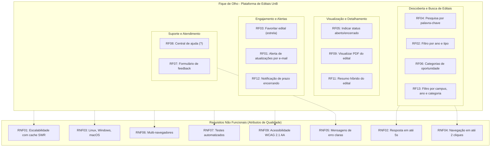

# Especificação de Requisitos - Fique de Olho (UnB Editais)

Este documento consolida os **Requisitos Funcionais (RF)** e **Requisitos Não Funcionais (RNF)** do projeto **Fique de Olho**, atualizados conforme o escopo entregue pela equipe.

---

## 🖼️ Registro Visual do Quadro de Requisitos

Abaixo encontra-se o link do Figma onde o quadro de requisitos foi originalmente elaborado:

- [Figma — Quadro de Requisitos](https://www.figma.com/board/Sw1R44AAXzZrW5eBolJybw/Template-MDS--c%25C3%25B3pia-limpa---c%25C3%25B3pia-?node-id=0-1&p=f&t=sEcwdIkLjWeMiq8P-0)

---

## ⚙️ 1. Requisitos Funcionais (RF)

Os requisitos funcionais descrevem os comportamentos, ações e serviços fornecidos pela plataforma **Fique de Olho**.

| Identificador | Nome do Requisito | Descrição | Status |
| :--- | :--- | :--- | :---: |
| **RF01** | Enviar notificações | O sistema deve enviar mensagens de aviso por e-mail ao usuário quando houver atualização relevante em um edital com alerta ativado. | ✅ Implementado |
| **RF02** | Filtrar ano/tipo | O sistema deve permitir que o usuário filtre os editais por ano de publicação e categoria/tipo de edital. | ✅ Implementado |
| **RF03** | Favoritar edital | O sistema deve permitir que o usuário salve o edital em sua lista pessoal de favoritos, utilizando um ícone de estrela. | ✅ Implementado |
| **RF04** | Buscar editais | O sistema deve permitir que o usuário pesquise os editais pelo nome, órgão ou palavras-chave. | ✅ Implementado |
| **RF05** | Identificar editais encerrados | O sistema deve indicar visualmente e por filtro de situação quando um edital estiver encerrado e quando estiver disponível/aberto. | ✅ Implementado |
| **RF06** | Separar por categorias | O sistema deve organizar e permitir a filtragem de editais por categorias de oportunidade (`Graduação`, `Pós-graduação`, `Intercâmbio`, `Bolsa`, `Pesquisa`, `Estágio`, `Extensão`, `Evento`, `Vestibular`). | ✅ Implementado |
| **RF07** | Enviar feedback | O sistema deve disponibilizar um formulário acessível para que os usuários possam enviar sugestões, críticas ou reportar problemas à equipe do projeto. | ✅ Implementado |
| **RF08** *(RF108)* | Central de ajuda | O sistema deve disponibilizar uma central de ajuda por meio de um botão de interrogação (`?`) localizado na extremidade da interface. | ✅ Implementado |
| **RF09** | Visualizar edital | O sistema deve permitir que o usuário abra e visualize o documento PDF oficial e anexos correspondentes ao edital. | ✅ Implementado |
| **RF11** | Resumir edital | O sistema deve apresentar um breve resumo do edital contendo informações essenciais (objeto, público-alvo, prazos e bolsas quando disponíveis). | ✅ Implementado |
| **RF12** | Avisar prazo | O sistema deve notificar o usuário por e-mail quando o prazo de inscrição de um edital com alerta ativado estiver se encerrando (3 dias, 1 dia e no dia do fechamento). | ✅ Implementado |
| **RF13** | Filtrar campos de interesse | O sistema deve permitir combinar filtros por campos de interesse específicos, como campus, ano de publicação, situação e categoria/tipo de oportunidade. | ✅ Implementado |

!!! note "Requisito removido do escopo"
    O requisito **RF10 (Exibir editais mais acessados)** foi removido do escopo desta entrega para priorizar a confiabilidade da coleta, a precisão dos filtros e o suporte ao usuário.

---

## 🛡️ 2. Requisitos Não Funcionais (RNF)

Os requisitos não funcionais estabelecem as qualidades, restrições e atributos operacionais que delimitam a solução técnica.

| Identificador | Categoria | Descrição | Métrica / Critério |
| :--- | :--- | :--- | :--- |
| **RNF01** | Desempenho / Escalabilidade | Usuários concorrentes | O sistema deve suportar acessos simultâneos sem degradação perceptível utilizando cache SWR e compressão GZip. |
| **RNF02** | Desempenho | Tempo de resposta | O sistema deve retornar resultados de busca e aplicação de filtros em até 5 segundos em condições normais de rede. |
| **RNF03** | Compatibilidade | Sistemas operacionais | O sistema deve funcionar corretamente em diferentes sistemas operacionais (Linux, Windows, macOS). |
| **RNF04** | Usabilidade | Navegação e agilidade | O sistema deve apresentar padrão de navegação intuitivo, permitindo acessar menu, busca e filtros com no máximo 2 cliques a partir da página inicial (Home). |
| **RNF05** | Confiabilidade / Usabilidade | Mensagens de erro | O sistema deve apresentar mensagens de erro claras e amigáveis, indicando a causa do problema e uma ação sugerida para resolução. |
| **RNF06** | Portabilidade | Suporte a navegadores | O sistema deve ser compatível e renderizar com fidelidade nos principais navegadores do mercado (Google Chrome, Mozilla Firefox, Safari, Microsoft Edge). |
| **RNF07** | Qualidade / Confiabilidade | Taxa de defeitos | O sistema deve ser submetido a testes funcionais e automatizados (`pytest` no backend e `vitest` no frontend), cobrindo os principais fluxos. |
| **RNF09** *(RNF08)* | Acessibilidade | Padrões de acessibilidade | O sistema deve seguir as diretrizes de acessibilidade WCAG 2.1 nível AA (HTML semântico, `aria-label`, foco por teclado e contraste adequado). |

---

## 🗺️ 3. Relação e Estrutura dos Requisitos

Veja os critérios verificáveis de cada item em [Critérios de Aceitação](Criterios%20de%20aceitacao.md).
