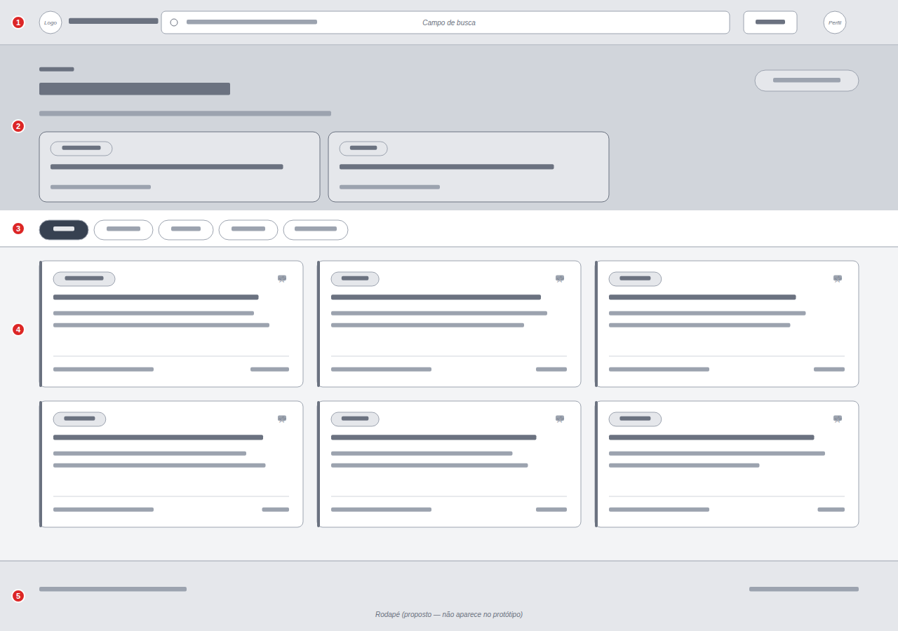
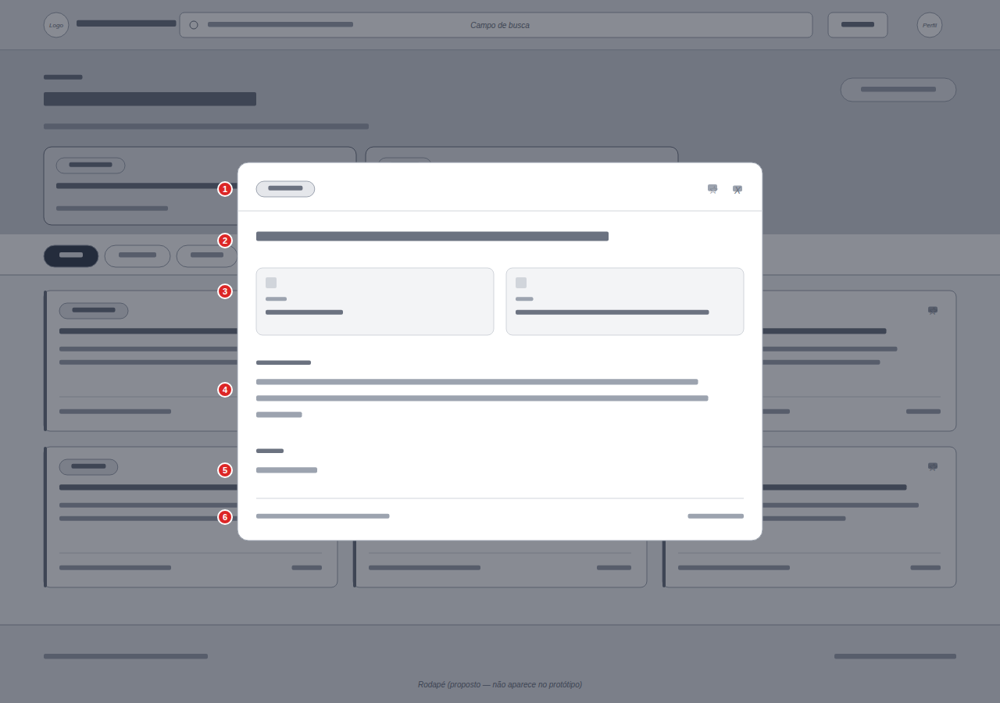
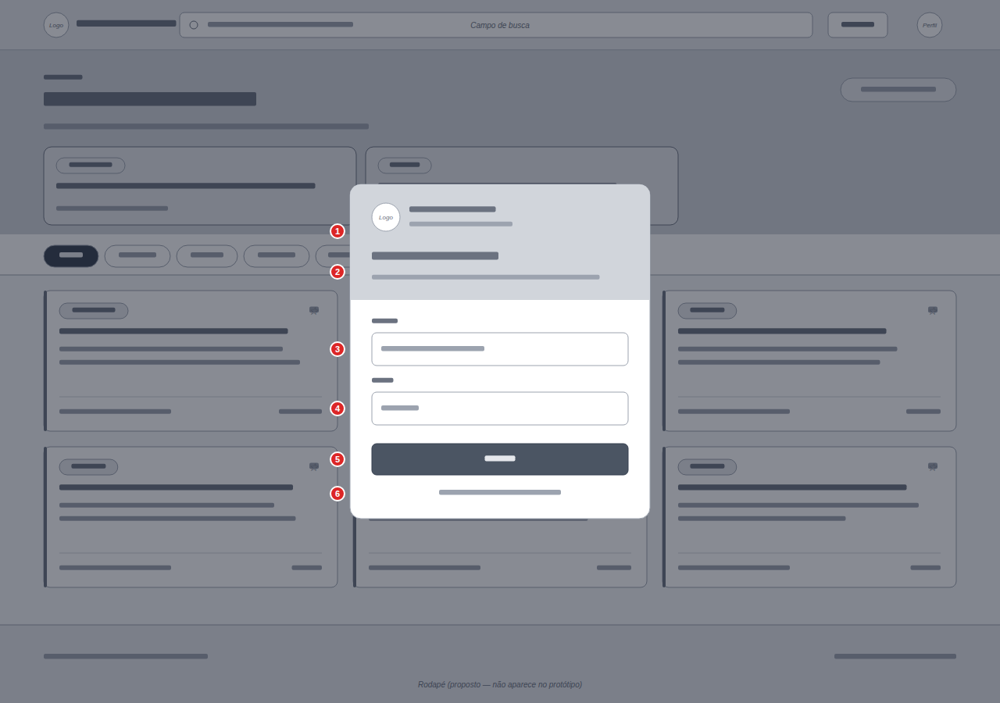

# Wireframes

## 1. Introdução

Este documento registra a estrutura das telas do **Portal de Editais UnB** em **baixa fidelidade**, para **desktop**. Os wireframes definem a hierarquia visual e a disposição dos blocos funcionais, servindo de base para o design de alta fidelidade.

- **Baixa fidelidade:** caixas e barras cinza, sem texto real. Mostram apenas *onde* cada bloco fica e seu peso visual.
- **Média fidelidade:** mesmo layout com textos reais, proporções e hierarquia tipográfica, ainda em escala de cinza.

🔗 **Protótipo de alta fidelidade no Figma:** [UnB Editais Aggregator Site](https://www.figma.com/make/yqHT0b3mk0T3EkHD2aUgns/UnB-Editais-Aggregator-Site)

**Legenda:** os círculos vermelhos numerados nas imagens correspondem às linhas das tabelas de cada tela.

---

## 2. Telas do sistema

| # | Tela | Descrição |
|---|------|-----------|
| 1 | Listagem de editais (home) | Busca, destaques, filtros por categoria e cards |
| 2 | Detalhe do edital | Modal aberto ao clicar em um card |
| 3 | Login | Modal aberto pelo ícone de perfil / ao favoritar |

---

## 3. Tela 1: Listagem de editais

### 3.1 Desktop

| Baixa fidelidade | |
|---|---|
|  |

| # | Bloco | Posição | Descrição |
|---|-------|---------|-----------|
| 1 | Cabeçalho + busca | Topo, largura total | Logo "UnB / Portal de Editais", campo de busca expandido, botão "Editais" e ícone de perfil |
| 2 | Destaques (hero) | Abaixo do cabeçalho | Rótulo "Destaques", título "Editais em Aberto", subtítulo, contador de editais ativos e 2 cards em destaque lado a lado |
| 3 | Filtros | Barra horizontal abaixo do hero | Chips de categoria: Todos, Pesquisa, Estágio, Extensão, Vestibular (um ativo por vez) |
| 4 | Listagem de cards | Área principal | Grade de **3 colunas**. Cada card: faixa lateral colorida, badge de categoria, favorito (★), título, resumo, data de início e nº de vagas |
| 5 | Rodapé | Base, largura total | Links institucionais e créditos *(proposto; não aparece no protótipo)* |

## 4. Tela 2: Detalhe do edital

### 4.1 Desktop (modal centralizado)

| Baixa fidelidade ||
|---|---|
|  |

| # | Bloco | Descrição |
|---|-------|-----------|
| 1 | Topo do modal | Badge de categoria, botão favoritar (★) e fechar (✕) |
| 2 | Título | Nome completo do edital |
| 3 | Informações-chave | Dois blocos lado a lado: **Início** e **Local** |
| 4 | Sobre o edital | Texto descritivo completo |
| 5 | Contato | E-mail do responsável |
| 6 | Rodapé do modal | Data de publicação e área |

Fundo da página desfocado/escurecido; fecha com ✕, clique fora ou `Esc`.

## 5. Tela 3: Login

### 5.1 Desktop (modal centralizado)

| Baixa fidelidade ||
|---|---|
|  |

| # | Bloco | Descrição |
|---|-------|-----------|
| 1 | Identidade | Logo UnB, "Portal de Editais" e "Universidade de Brasília" |
| 2 | Boas-vindas | "Bem-vindo de volta" + frase explicando o benefício (salvar e acompanhar favoritos) |
| 3 | Campo E-mail | Input com placeholder `seu.email@aluno.unb.br` |
| 4 | Campo Senha | Input mascarado |
| 5 | Botão "Entrar" | Ação principal, largura total |
| 6 | Link "Criar conta" | Alterna para o cadastro |

---

## 8. Referências

- [Protótipo no Figma](https://www.figma.com/make/yqHT0b3mk0T3EkHD2aUgns/UnB-Editais-Aggregator-Site)