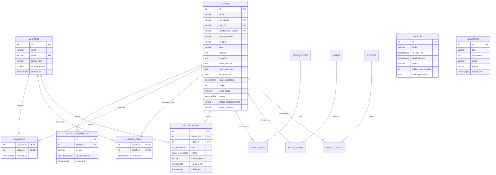

# Banco de Dados & Migrations

O banco de dados do **Fique de Olho** utiliza **PostgreSQL 16** (Docker localmente e **Neon** em produção), modelado em SQLAlchemy em `Back/app/core/database.py` e versionado exclusivamente via **Alembic** em `Back/migrations/`.

---

## Diagrama Entidade-Relacionamento (ER)



---

## Catálogo das 14 tabelas

### Núcleo de Editais e Documentos

| Tabela | Chave primária | Regras, índices e finalidade |
| :--- | :--- | :--- |
| `editais` | `id` (`SERIAL`) | Entidade central. Possui unicidade em `url_pagina` (chave de idempotência da coleta), `url_pdf` e `identificador_origem`; índices em `url_pagina`, `fim_inscricao` e `orgao_emissor`. |
| `edital_documentos` | `id` (`SERIAL`) | Anexos oficiais vinculados a um edital (`original`, `retificacao`, `resultado_provisorio`, `resultado_final`). Índice em `edital_id`. |

#### Constraints de integridade em `editais`
- `editais_periodo_inscricao_ck`: garante `inicio_inscricao IS NULL OR fim_inscricao IS NULL OR inicio_inscricao <= fim_inscricao`.
- `editais_status_processamento_ck`: restringe `status_processamento` a `'pendente'`, `'processado'`, `'parcialmente_processado'` ou `'erro'`.

### Catálogos controlados (M:N)

| Tabela | Relacionamento | Política de exclusão |
| :--- | :--- | :--- |
| `tipos_editais`, `campi`, `cursos` | Catálogos normalizados com `nome` único | `ON DELETE RESTRICT` nas tabelas associativas (impede remover valor em uso). |
| `edital_tipos`, `edital_campi`, `edital_cursos` | Tabelas associativas com PK composta `(edital_id, <catalogo>_id)` | `ON DELETE CASCADE` a partir de `editais.id`. |

### Usuários, Favoritos, Alertas e Notificações

| Tabela | Chave primária | Regras e finalidade |
| :--- | :--- | :--- |
| `usuarios` | `id` (`SERIAL`) | `email` único e indexado; `senha_hash` em Argon2; `receber_emails` (`true` por padrão) controla opt-in/opt-out global. |
| `favoritos` | `(usuario_id, edital_id)` | Lista pessoal de acompanhamento (salvo pelo estudante, **não** dispara e-mails sozinho). |
| `alertas_edital` | `(usuario_id, edital_id)` | Ativação explícita de e-mails para um edital específico (`ON DELETE CASCADE`). Índice em `edital_id`. |
| `notificacoes` | `id` (`SERIAL`) | Histórico e fila de envio com constraint única `uq_notificacao_evento (usuario_id, edital_id, tipo, chave_evento)` que impede e-mails duplicados. |

### Observabilidade da Coleta e Feedback

| Tabela | Chave primária | Finalidade |
| :--- | :--- | :--- |
| `coletas` | `id` (`SERIAL`) | Registra cada execução por `fonte` (ex.: `DEG`, `INT`), timestamps `iniciada_em`/`finalizada_em`, `status` (`executando`, `sucesso`, `erro`), `editais_encontrados` e `mensagem_erro`. |
| `feedbacks` | `id` (`SERIAL`) | Armazena sugestões, relatos de problema e elogios enviados pela Central de Ajuda (`tipo`, `mensagem`, `email`, `pagina`, `criado_em`), além do encaminhamento por e-mail. |

---

## Enums nativos do PostgreSQL

| Enum SQL | Valores Python / JSON | Uso |
| :--- | :--- | :--- |
| `status_edital` | `aberto`, `encerrado` | Situação persistida na coleta (`StatusEdital`). |
| `tipo_documento` | `original`, `resultado_provisorio`, `resultado_final`, `retificacao` | Classificação de cada documento anexo (`TipoDocumento`). |
| `tipo_notificacao` | `edital_atualizado`, `prazo_encerrando` | Tipo de evento que gerou a notificação (`TipoNotificacao`). |
| `status_notificacao` | `pendente`, `enviada`, `falhou` | Estado do envio via SendGrid (`StatusNotificacao`). |

---

## Conexão e compatibilidade com Neon

Em `Back/app/core/database.py`, o engine SQLAlchemy é configurado pensando no **auto-suspend de 5 minutos** do Neon Serverless:

```python
engine = create_engine(
    settings.DATABASE_URL,
    pool_pre_ping=True,  # testa se a conexão está viva antes de entregar à requisição
    pool_recycle=300,    # recicla conexões antes da janela de auto-suspend do Neon
)
```

---

## Migrations com Alembic

!!! warning "Regra de ouro do schema"
    O startup da API (`app/main.py`) **nunca** chama `Base.metadata.create_all()`. Toda alteração de tabela, coluna, índice ou enum deve ser feita via revisão Alembic em `Back/migrations/versions/`.

### Histórico de revisões atuais

1. `0001_initial_schema.py` — Tabelas iniciais (`editais`, `edital_documentos`, `usuarios`, `favoritos`) e enums básicos.
2. `0002_notifications.py` — Tabela `notificacoes` e enums de notificação.
3. `0003_email_preference.py` — Preferência `usuarios.receber_emails`.
4. `0003_reconcilia_metadados.py` — Metadados de editais (`orgao_emissor`, `vagas`, `valor_bolsa`, `inicio_inscricao`, `fim_inscricao`, catálogos M:N e `coletas`).
5. `0004_merge_notification_metadata.py` — Merge de heads do histórico Alembic.
6. `0005_alertas_edital.py` — Tabela `alertas_edital` separando alertas por e-mail de favoritos.
7. `0006_feedbacks.py` — Tabela `feedbacks` para armazenamento de sugestões e relatos de problema (RF07).

### Comandos do dia a dia

=== "Dentro do Docker Compose"

    ```powershell
    # Conferir revisão atual aplicada no banco
    docker exec fique-de-olho-api alembic current

    # Aplicar todas as migrations pendentes
    docker exec fique-de-olho-api alembic upgrade head

    # Gerar nova migration após alterar Back/app/core/database.py
    docker exec fique-de-olho-api alembic revision --autogenerate -m "descricao_curta"
    ```

=== "Local (venv em Back/)"

    ```powershell
    cd Back
    alembic current
    alembic upgrade head
    alembic revision --autogenerate -m "descricao_curta"
    ```

!!! danger "Validação obrigatória em PostgreSQL real"
    Testes unitários em SQLite em memória **não** validam enums nativos nem `CheckConstraint` do PostgreSQL. Antes de abrir PR com migration, valide `alembic upgrade head` (e `downgrade` apenas em banco descartável local — **nunca** rode `downgrade` em produção).
