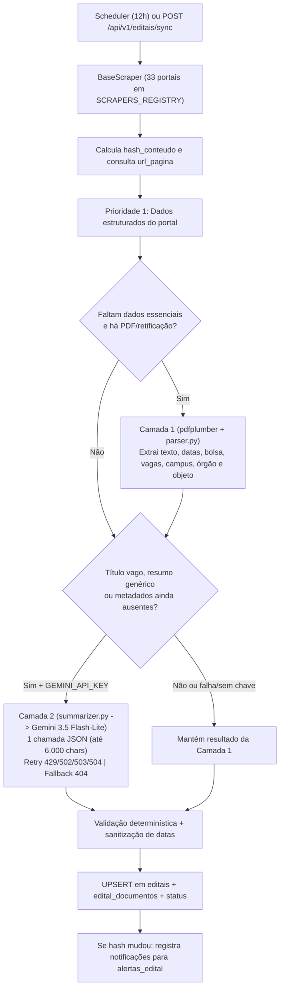

# Pipeline de Coleta, PDF & IA

A ingestão de editais do **Fique de Olho** combina raspagem multi-portal (33 fontes da UnB), extração determinística de PDFs (**Camada 1**, offline e custo zero) e enriquecimento opcional por LLM (**Camada 2**, Google Gemini com degradação graciosa).

---

## Fluxo ponta a ponta



---

## Os 33 portais registrados (`SCRAPERS_REGISTRY`)

Todos os scrapers herdam de `BaseScraper` (`Back/app/modules/scraper/base.py`), implementando `orgao_origem`, `fetch_editais(year=None)` e `fetch_documentos(edital_url)`, e são registrados em `Back/app/modules/scraper/__init__.py`.

| Grupo | Siglas registradas |
| :--- | :--- |
| **Decanatos e Administração** | `DEG`, `DPG`, `DEX`, `DPI`, `DAC`, `DGP`, `DAF`, `PRC` |
| **Internacionalização e Programas** | `INT`, `PROIC`, `DACES`, `CEAD`, `UNB_IDIOMAS`, `OCEAN` |
| **Sistemas, Bancas e Diário Oficial** | `SIGAA`, `CEBRASPE`, `CONCURSOS`, `DOU` |
| **Inovação, Hospitais e Fundações** | `FINATEC`, `CDT`, `PCTEC`, `HUB`, `FAL` |
| **Bibliotecas, Cultura, Esporte e Mídia** | `BCE`, `CEL`, `CAL`, `EDU`, `UNBTV` |
| **Faculdades e PPGs específicos** | `FUP`, `FACE`, `DIREITO`, `PPGCONT`, `PPGGIPP` *(alias `PPGIPP`)* |

!!! info "Suporte a links do SEI e Google Drive"
    - O extrator de PDF (`pdf.py`) converte automaticamente links de visualização do **Google Drive** (`/file/d/<ID>/view` e `open?id=<ID>`) para download direto.
    - O scraper da **INT** (`int_scraper.py`) captura tanto anexos `.pdf` quanto publicações oficiais do **SEI (`sei.unb.br/sei/publicacoes/`)**, recuperando o rótulo real quando o link diz `"baixar em PDF"` para detectar `Resultado Final` e `Resultado Definitivo`.

---

## Camada 1 vs Camada 2 (Enriquecimento Híbrido)

### Camada 1 — Heurística local (sempre ativa)
- **`Back/app/modules/scraper/pdf.py`:** baixa o PDF via `httpx` e extrai texto + tabelas por página com `pdfplumber` (sem dependências pesadas de OCR/ML para caber nos 512 MB de RAM do Render Free).
- **`Back/app/modules/scraper/parser.py`:** aplica regex e heurísticas específicas para editais da UnB:
  - `inicio_inscricao` e `fim_inscricao` (inclusive em tabelas de cronograma e PDFs de retificação, priorizando prorrogações maiores);
  - `valor_bolsa` (filtrando taxas de inscrição e orçamentos globais) e `vagas`;
  - `orgao_emissor`, `campus`, reconstrução de títulos vagos (`is_vague_title`) e extração do objeto do edital para resumo.

### Camada 2 — Google Gemini (opcional, 1 chamada unificada)
Implementada em `Back/app/modules/scraper/summarizer.py`, só é acionada se **`GEMINI_API_KEY`** estiver definida **e** ainda faltar informação após a Camada 1:

- **Recorte inteligente (`selecionar_trechos_relevantes_prompt`):** envia no máximo `6.000` caracteres por chamada, combinando 45% de cabeçalho/objeto, 40% de janelas em torno de *cronograma / inscrições / bolsa / vagas* e 15% do trecho final do documento.
- **Modelo primário e fallback automático:** usa `GEMINI_MODEL=gemini-3.5-flash-lite` (Free Tier sem cobrança enquanto não houver billing vinculado no Google AI Studio). Se retornar HTTP `404`, troca automaticamente para `GEMINI_FALLBACK_MODEL=gemini-flash-lite-latest`.
- **Resiliência (graceful degradation):**
  - Erros transitórios (`429`, `502`, `503`, `504`) disparam **1 retry automático** respeitando `Retry-After` ou `GEMINI_RETRY_DELAY_SECONDS` (padrão `2.0s`, teto `10s`).
  - Qualquer falha (timeout de `15s`, JSON inválido, cota esgotada) gera apenas `logger.warning` e retorna o resultado da Camada 1 — **nunca interrompe a coleta**.
  - Todas as datas e valores retornados pelo LLM passam por validação e sanitização determinística (`_converter_metadados_llm` e `_sanitize_periodo_inscricao`) antes de gravar no banco.

---

## Idempotência e cálculo de status na ingestão

1. **Deduplicação:** cada edital é identificado de forma única por `url_pagina` e versionado via SHA-256 (`hash_conteudo`). Reprocessamentos de editais já completos com mesmo hash não baixam o PDF nem chamam o Gemini novamente.
2. **Encerramento automático (`_resolve_edital_status`):** um edital é gravado como `ENCERRADO` quando:
   - possui documento classificado como `RESULTADO_FINAL` (*Resultado Final*, *Resultado Definitivo* ou *Homologação*);
   - o scraper informa `status` como `fechado`/`encerrado`;
   - o título indica encerramento;
   - `fim_inscricao < hoje`; ou
   - `fim_inscricao` é nulo e `data_publicacao` pertence a um ano anterior ao atual.

---

## Execução agendada e Backfill CLI

### Scheduler automático (`Back/app/modules/scraper/scheduler.py`)
Executado em segundo plano no `lifespan` do FastAPI via `asyncio.to_thread` (sem bloquear o event loop) a cada `SCRAPER_SCHEDULER_INTERVAL_HOURS` (padrão `12h`), com isolamento de falhas por órgão gravado na tabela `coletas`.

### Script de Backfill (`backfill_titles_summaries.py`)
Reprocessa editais já salvos no banco que têm `texto_extraido`, mas ainda estão com título vago, resumo genérico ou datas ausentes — **sem baixar PDFs novamente**.

=== "Docker Compose"

    ```powershell
    # Dry-run: apenas mostra o que seria atualizado (não grava no banco)
    docker exec fique-de-olho-api python -m app.modules.scraper.backfill_titles_summaries --limit 5 --sleep 2.0

    # Aplicar alterações no banco (filtrando por órgão se desejar)
    docker exec fique-de-olho-api python -m app.modules.scraper.backfill_titles_summaries --orgao DEG --limit 20 --sleep 2.0 --apply

    # Rodar apenas com Camada 1 (sem chamar Gemini)
    docker exec fique-de-olho-api python -m app.modules.scraper.backfill_titles_summaries --no-llm --apply
    ```

=== "Local (venv em Back/)"

    ```powershell
    cd Back
    python -m app.modules.scraper.backfill_titles_summaries --limit 5 --sleep 2.0
    python -m app.modules.scraper.backfill_titles_summaries --limit 20 --sleep 2.0 --apply
    ```
