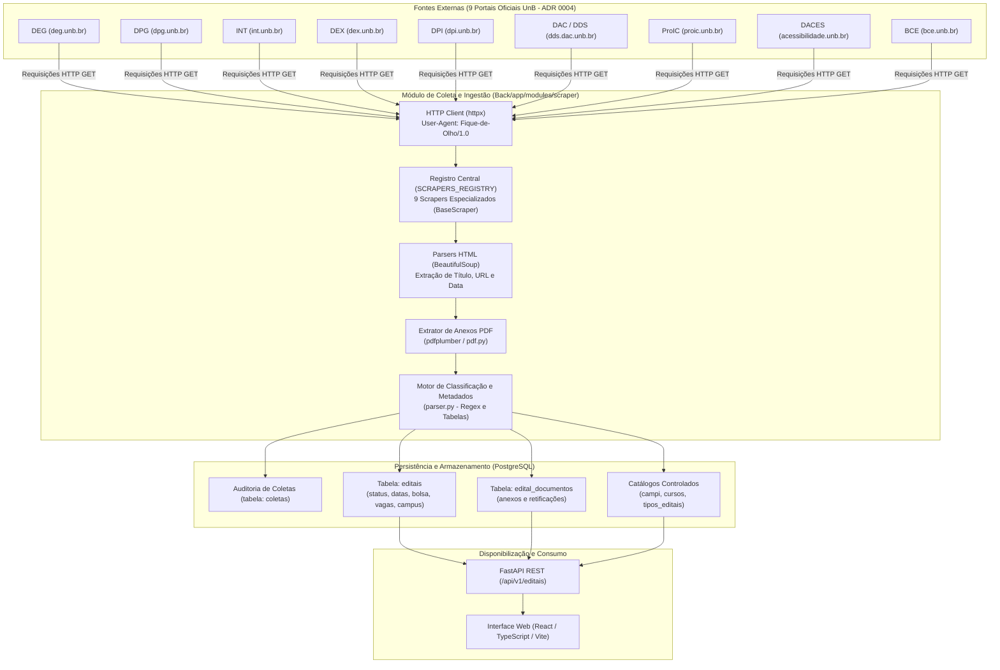

# Mapeamento e Proveniência de Fontes de Dados

Este documento descreve detalhadamente a origem dos dados manipulados pela plataforma **Fique de Olho - UnB Editais** (MDS - UnB 2026/2), os mecanismos de coleta/ingestão, o pipeline de extração e transformação, o mapeamento para o modelo de dados relacional e as políticas de governança, resiliência e conformidade legal.

---

## 1. Visão Geral do Pipeline de Dados

O fluxo a seguir ilustra a jornada do dado desde a publicação nos portais oficiais da Universidade de Brasília até a disponibilização para os estudantes na interface web:

---

## 2. Catálogo de Fontes de Dados

### 2.1. Arquitetura Modular e Padronização (`BaseScraper`)

Com a evolução trazida pelo **PR #76** (`feat/scrapers-8-orgaos-unb`), todos os scrapers do projeto implementam a classe abstrata [`BaseScraper`](file:///c:/Users/user/Desktop/Projetos%20de%20programacao/MDS/G4-2026-2/Back/app/modules/scraper/base.py), estabelecendo um contrato único para todos os portais:

- `orgao_origem`: Propriedade abstrata indicando a sigla oficial (ex: `"DEG"`, `"DPG"`, `"DEX"`, etc.).
- `fetch_editais(year=None)`: Busca e extrai a listagem de editais em formato estruturado (`titulo`, `link`, `data_publicacao`).
- `fetch_documentos(edital_url)`: Extrai os anexos e PDFs associados a um edital específico (`titulo`, `link`, `tipo`).
- `download_documento(url)`: Download padronizado de documentos com tratamento de streaming e timeout.

Todos os coletores estão unificados e centralizados no dicionário `SCRAPERS_REGISTRY` em [`Back/app/modules/scraper/__init__.py`](file:///c:/Users/user/Desktop/Projetos%20de%20programacao/MDS/G4-2026-2/Back/app/modules/scraper/__init__.py), permitindo resolução direta via `get_scraper(sigla)`.

---

### 2.2. Fonte Ativa e Integrada: Decanato de Ensino de Graduação (DEG)

Primeira fonte implementada e atualmente conectada ao pipeline de persistência direta (`Back/app/modules/scraper/deg.py`).

| Propriedade | Especificação Técnica |
| :--- | :--- |
| **Identificador** | `SRC-UNB-DEG` |
| **Classe / Módulo** | `DEGScraper` (`deg_scraper`) em `app.modules.scraper.deg` |
| **Órgão Responsável** | Decanato de Ensino de Graduação (DEG) - Universidade de Brasília |
| **URL Base de Listagem** | `https://deg.unb.br/editais/` (ou `https://deg.unb.br/editais-{ano}/`) |
| **Tipo de Interface** | Web Scraping (HTML estático renderizado no servidor WordPress) |
| **Mecanismo de Requisição** | `httpx.get` com `follow_redirects=True`, timeout padrão de 10.0s |
| **User-Agent Utilizado** | `Fique-de-Olho/1.0` |
| **Seletores HTML Principais** | Cabeçalhos `<h6>` contendo tags `<a>` para os editais; `.entry-content` para links de PDFs |
| **Padrão de Data Identificado** | Regex para formato por extenso (`DD de Mês de YYYY`) ou numérico (`DD/MM/YYYY`) |
| **Tipos de Oportunidades** | Monitoria, transferência facultativa, portador de diploma, prêmios e bolsas de graduação |
| **Status da Integração** | **Scraper Ativo e Integrado ao Pipeline de Banco** |

---

### 2.3. Scrapers dos 8 Órgãos Institucionais (ADR 0004 & PR #76)

Conforme deliberado na [ADR 0004](adr/0004-escopo-Editais.md) e implementado via **PR #76**, os 8 novos portais institucionais contam com módulos dedicados, classes concretas derivadas de `BaseScraper` e testes unitários automatizados em [`Back/tests/test_novos_scrapers.py`](file:///c:/Users/user/Desktop/Projetos%20de%20programacao/MDS/G4-2026-2/Back/tests/test_novos_scrapers.py):

| ID Fonte | Órgão / Portal | Módulo & Classe | Categoria do Edital | URL Oficial de Origem | Status Atual |
| :--- | :--- | :--- | :--- | :--- | :--- |
| `SRC-UNB-DPG` | **DPG** (Decanato de Pós-Graduação) | `dpg.py` `DPGScraper` | Pós-graduação, mestrado, doutorado e pesquisa | `https://dpg.unb.br/editais-abertos/` | **Scraper Pronto & Testado** (Aguardando unificação no pipeline) |
| `SRC-UNB-INT` | **INT** (Secretaria de Assuntos Internacionais) | `int_scraper.py` `INTScraper` | Intercâmbio acadêmico e internacionalização | `https://int.unb.br/selecoes-abertas/` | **Scraper Pronto & Testado** (Aguardando unificação no pipeline) |
| `SRC-UNB-DEX` | **DEX** (Decanato de Extensão) | `dex.py` `DEXScraper` | Ações, projetos e bolsas de extensão | `https://dex.unb.br/editais` | **Scraper Pronto & Testado** (Aguardando unificação no pipeline) |
| `SRC-UNB-DPI` | **DPI** (Decanato de Pesquisa e Inovação) | `dpi.py` `DPIScraper` | Projetos de pesquisa e fomento à inovação | `https://dpi.unb.br/editais/editais2026` | **Scraper Pronto & Testado** (Aguardando unificação no pipeline) |
| `SRC-UNB-DAC` | **DAC / DDS** (Decanato de Assuntos Comunitários) | `dac.py` `DACScraper` | Assistência estudantil, auxílio moradia e alimentação | `https://dds.dac.unb.br/editais/` | **Scraper Pronto & Testado** (Aguardando unificação no pipeline) |
| `SRC-UNB-PROIC`| **ProIC** (Programa de Iniciação Científica) | `proic.py` `PROICScraper` | Bolsas PIBIC, PIBITI e iniciação científica | `https://proic.unb.br/editais/` | **Scraper Pronto & Testado** (Aguardando unificação no pipeline) |
| `SRC-UNB-DACES`| **DACES** (Diretoria de Acessibilidade) | `daces.py` `DACESScraper` | Acessibilidade e apoio pedagógico especializado | `https://acessibilidade.unb.br/editais-2/` | **Scraper Pronto & Testado** (Aguardando unificação no pipeline) |
| `SRC-UNB-BCE` | **BCE** (Biblioteca Central) | `bce.py` `BCEScraper` | Normativos, seleções e capacitações da biblioteca | `https://bce.unb.br/sacc/editais-e-normativos/` | **Scraper Pronto & Testado** (Aguardando unificação no pipeline) |

#### Detalhes Técnicos dos Novos Scrapers:
- **DPG (`dpg.py`)**: Realiza busca estruturada em blocos de editais abertos e links diretos em PDF, com filtros que descartam links de rodapé/governo.
- **INT (`int_scraper.py`)**: Mapeia páginas de chamadas internacionais abertas em `.entry-content` e seus cronogramas anexos.
- **DEX (`dex.py`)**: Coleta editais de bolsas de extensão e chamadas públicas de projetos comunitários.
- **DPI (`dpi.py`)**: Extrai editais de inovação e pesquisa categorizados por exercício anual.
- **DAC / DDS (`dac.py`)**: Focado no portal da Diretoria de Desenvolvimento Social (DDS), capturando editais de assistência socioeconômica e alimentação.
- **ProIC (`proic.py`)**: Extrai as chamadas dos programas de iniciação científica (PIBIC/PIBITI/PIBIC-AF).
- **DACES (`daces.py`)**: Raspa editais e comunicados de apoio e bolsas a estudantes com deficiência.
- **BCE (`bce.py`)**: Coleta seleções para bolsistas da biblioteca e editais normativos.

---

## 3. Mapeamento de Atributos e Linhagem de Dados (*Lineage*)

Abaixo está discriminada a transformação dos dados brutos obtidos no HTML/PDF dos portais da UnB para a estrutura de entidades do banco de dados relacional (`Back/app/modules/editais/models.py`).

### 3.1. Tabela Principal: `editais`

| Campo no Modelo (`Edital`) | Tipo no Banco | Origem no Scraper / Parser | Regra de Transformação / Limpeza |
| :--- | :--- | :--- | :--- |
| `id` | `BIGINT` (PK) | Gerado automaticamente | Auto-incremento sequencial do PostgreSQL |
| `identificador_origem` | `VARCHAR(200)` | Slug ou Hash do link de origem | Normalização alfanumérica para garantir idempotência |
| `titulo` | `VARCHAR(500)` | Texto do link no cabeçalho ou tag `<a>` | Remoção de espaços duplos e quebras de linha (`strip()`) |
| `resumo` | `TEXT` | `parser.py` / NLP | Extração automática ou seleção dos primeiros parágrafos do edital |
| `url_pdf` | `TEXT` (Unique) | Primeiro link de PDF associado à página do edital | Resolução de caminho absoluto com `urllib.parse.urljoin` |
| `texto_extraido` | `TEXT` | `pdfplumber` no binário baixado | Extração textual pura de todas as páginas do PDF oficial |
| `data_publicacao` | `DATE` | String adjacente ao título na listagem | Conversão de nomes de meses em PT-BR para `datetime.date` |
| `inicio_inscricao` | `DATE` | Parser de cronograma (`parser.py`) | Regex em intervalos de datas (ex.: *"23 de setembro a 14 de outubro"*) |
| `fim_inscricao` | `DATE` | Parser de cronograma (`parser.py`) | Data final do intervalo de inscrições identificado |
| `status_processamento` | `VARCHAR(30)` | Ciclo de vida interno | `pendente` $\rightarrow$ `processado` / `parcialmente_processado` / `erro` |
| `hash_conteudo` | `VARCHAR(64)` | Hash SHA-256 do arquivo PDF | Permite detectar se a UnB atualizou silenciosamente o PDF |
| `criado_em` / `atualizado_em`| `TIMESTAMP(tz)` | `func.now()` do servidor | Data/hora de inserção e atualização no banco |

---

### 3.2. Classificação de Documentos e Retificações: `edital_documentos`

Os documentos anexos vinculados a cada página de edital são classificados com base no nome do arquivo e texto âncora:

| Tipo (`TipoDocumento`) | Palavras-Chave de Origem | Regra de Negócio Associada |
| :--- | :--- | :--- |
| `ORIGINAL` | Padrão default quando não há qualificadores | Primeiro documento convocatório do processo seletivo |
| `RETIFICACAO` | `retificacao`, `errata`, `alteracao` | Altera itens de um edital existente mantendo o mesmo vínculo |
| `RESULTADO_PROVISORIO`| `resultado provisorio`, `preliminar`, `parcial` | Notifica usuários que favoritaram sobre a primeira lista |
| `RESULTADO_FINAL` | `resultado final`, `homologacao` | **Encerra o edital**, alterando seu status para `encerrado` |

---

### 3.3. Associação com Catálogos Controlados

O sistema categoriza os editais utilizando tabelas auxiliares M:N:

1. **Campi (`campi`)**:
   - Detectado via regex fonético em `parser.py`: Darcy Ribeiro (Plano Piloto), FGA (Gama), FCE (Ceilândia), FUP (Planaltina) ou Geral.
2. **Tipos de Edital (`tipos_editais`)**:
   - Classificação controlada: `Extensões`, `Bolsas / Auxílios`, `Pós-Graduação`, `Graduação`, `Pesquisa`, `Intercâmbio`, `Acessibilidade`.
3. **Cursos (`cursos`)**:
   - Critério de vinculação textual a partir dos cursos mencionados no corpo do edital.

---

## 4. Política de Ingestão e Resiliência

### 4.1. Gatilho de Execução da Coleta

- **Situação Atual do Pipeline (`Back/app/modules/scraper/pipeline.py`)**:
  - A função `run_pipeline(db, year, fetch_docs)` atualmente realiza a ingestão automática do scraper do **DEG**.
  - Os demais 8 scrapers estão prontos para uso em `SCRAPERS_REGISTRY`.
- **Próximo Passo de Integração (Unificação de Pipeline)**:
  - Evolução do `run_pipeline()` para iterar sobre `SCRAPERS_REGISTRY.values()`, garantindo a coleta e o upsert de todos os órgãos em uma única execução.
- **Disparo Manual / Manutenção**:
  - Execução via CLI: `python -m app.modules.scraper.pipeline [ano]`.

### 4.2. Auditoria e Rastreabilidade (`coletas`)

Cada ciclo de coleta gera um registro na tabela `coletas` com:
- `fonte`: Nome ou sigla do órgão consultado (ex.: `"DEG"`, `"DPG"`, `"DEX"`).
- `iniciada_em` / `finalizada_em`: Duração e timestamp do processo.
- `status`: `'executando'`, `'concluida'`, `'falhou'`.
- `editais_encontrados`: Quantidade de registros identificados.
- `mensagem_erro`: Mensagem de erro em caso de exceção de rede/parsing.

### 4.3. Resiliência e Tratamento de Falhas

- **Falha de Conectividade com os Portais**: Erros de HTTP (`httpx.HTTPError`, timeouts, DNS) são capturados e tratados individualmente por órgão, retornando lista vazia sem interromper a execução dos demais scrapers.
- **Idempotência de Ingestão**: Novos editais são inseridos com base na unicidade de `url_pagina` e `url_pdf`. Registros existentes sofrem `UPSERT` (atualização de datas, título e novos anexos sem duplicação).
- **Alteração de Layout HTML**: Tratado defensivamente com `.get()` e seletores tolerantes a nós ausentes.

---

## 5. Aspectos Legais, LGPD e Governança de Dados

### 5.1. Natureza Pública dos Dados

- Os editais e comunicados coletados são **documentos públicos oficiais**, disponibilizados abertamente pelos portais institucionais da Universidade de Brasília em atendimento à **Lei de Acesso à Informação (Lei Federal nº 12.527/2011)** e ao princípio da publicidade administrativa (Art. 37 da Constituição Federal).

### 5.2. Conformidade com a LGPD (Lei nº 13.709/2018)

- **Tratamento de Dados Pessoais em Listas de Resultados**:
  - Editais e resultados homologados podem conter nomes e matrículas de estudantes aprovados.
  - O sistema armazena preferencialmente metadados estruturais (prazos, bolsas, vagas, regras).
- **Link para a Fonte Original**:
  - O sistema sempre mantém e destaca o link canônico do documento oficial no site da UnB (`url_pdf` e `url_pagina`), garantindo que o estudante consulte a versão legalmente válida.

### 5.3. Política de "Bom Cidadão" na Web (*Etiqueta de Scraping*)

- Identificação explícita do agente via cabeçalho `User-Agent: Fique-de-Olho/1.0`.
- Intervalos de espera adequados entre requisições para evitar sobrecarga dos servidores da UnB.
- Download condicional de PDFs baseado em verificação prévia de links já armazenados no PostgreSQL.

---

## 6. Pontos em Aberto e Próximos Passos (Backlog de Decisões)

- [x] **Arquitetura Base (`BaseScraper`)**: Criação da interface abstrata para padronizar coleta e extração de documentos.
- [x] **Implementação dos 8 Novos Scrapers (PR #76 - ADR 0004)**: Coletores implementados e testados para DPG, INT, DEX, DPI, DAC, PROIC, DACES e BCE.
- [x] **Registro Central (`SCRAPERS_REGISTRY`)**: Centralização das instâncias de todos os 9 órgãos da UnB no pacote `scraper`.
- [ ] **Unificação do Pipeline de Ingestão**: Atualizar `run_pipeline()` para iterar sobre todos os scrapers de `SCRAPERS_REGISTRY` e persistir os editais no banco de dados.
- [ ] **Definição do Agendamento**: Escolher a infraestrutura e periodicidade para a execução contínua da ingestão (ex.: Cron job, Celery Beat ou GitHub Actions).
- [ ] **Diretriz de Privacidade / LGPD**: Definir se o texto extraído de listas de resultados passará por mascaramento de dados de estudantes.
- [ ] **Mapeamento Automático de Cursos**: Definir regras de associação textual automática aos cursos da UnB.
