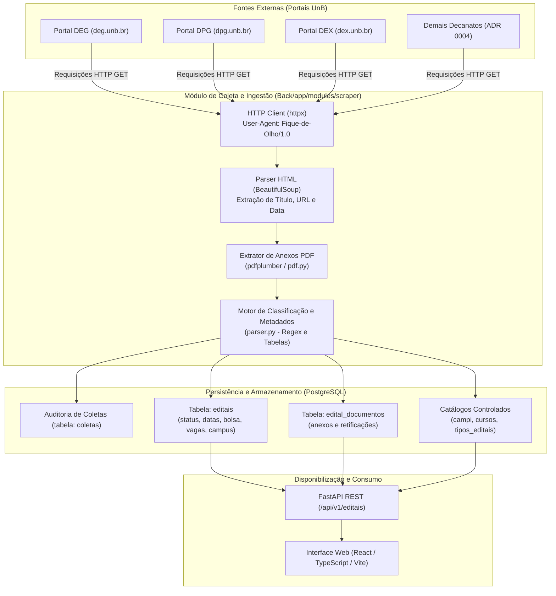

# Mapeamento e Proveniência de Fontes de Dados

Este documento descreve detalhadamente a origem dos dados manipulados pela plataforma **Fique de Olho - UnB Editais** (MDS - UnB 2026/2), os mecanismos de coleta/ingestão, o pipeline de extração e transformação, o mapeamento para o modelo de dados relacional e as políticas de governança, resiliência e conformidade legal.

---

## 1. Visão Geral do Pipeline de Dados

O fluxo a seguir ilustra a jornada do dado desde a publicação nos portais oficiais da Universidade de Brasília até a disponibilização para os estudantes na interface web:

---

## 2. Catálogo de Fontes de Dados

### 2.1. Fonte Ativa: Decanato de Ensino de Graduação (DEG)

Esta é a principal fonte implementada e ativa no serviço de coleta atual (`Back/app/modules/scraper/deg.py`).

| Propriedade | Especificação Técnica |
| :--- | :--- |
| **Identificador** | `SRC-UNB-DEG` |
| **Órgão Responsável** | Decanato de Ensino de Graduação - Universidade de Brasília |
| **URL Base de Listagem** | `https://deg.unb.br/editais/` (ou `https://deg.unb.br/editais-{ano}/`) |
| **Tipo de Interface** | Web Scraping (HTML estático renderizado no servidor WordPress) |
| **Mecanismo de Requisição** | `httpx.get` com `follow_redirects=True`, timeout padrão de 10.0s |
| **User-Agent Utilizado** | `Fique-de-Olho/1.0` |
| **Seletores HTML Principais** | Cabeçalhos `<h6>` contendo tags `<a>` para os editais; `.entry-content` para links de PDFs |
| **Padrão de Data Identificado** | Regex para formato por extenso (`DD de Mês de YYYY`) ou numérico (`DD/MM/YYYY`) |
| **Tipos de Oportunidades** | Transferência facultativa, portador de diploma, monitoria, bolsas de graduação |
| **Status da Integração** | **Ativo / Implementado** |

---

### 2.2. Fontes Planejadas para Expansão (Conforme ADR 0004)

Conforme deliberado na [ADR 0004](adr/0004-escopo-Editais.md), o sistema prevê a integração progressiva dos seguintes portais institucionais. O cronograma de implementação e a priorização de cada fonte estão em aberto e serão decididos pela equipe nas próximas sprints:

| ID Fonte | Portal / Órgão | Categoria do Edital | URL Oficial de Origem | Status da Coleta |
| :--- | :--- | :--- | :--- | :--- |
| `SRC-UNB-DPG` | Decanato de Pós-Graduação (DPG) | Pós-graduação, mestrado, doutorado e pesquisa | `https://dpg.unb.br/editais-abertos/` | A definir (Planejado) |
| `SRC-UNB-INT` | Secretaria de Assuntos Internacionais (INT) | Intercâmbio acadêmico e internacionalização | `https://int.unb.br/selecoes-abertas/` | A definir (Planejado) |
| `SRC-UNB-DEX` | Decanato de Extensão (DEX) | Ações, projetos e bolsas de extensão | `https://dex.unb.br/editais` | A definir (Planejado) |
| `SRC-UNB-DPI` | Decanato de Pesquisa e Inovação (DPI) | Projetos de pesquisa e fomento à inovação | `https://dpi.unb.br/editais/editais2026` | A definir (Planejado) |
| `SRC-UNB-DAC` | Decanato de Assuntos Comunitários (DAC / DDS) | Assistência estudantil, auxílio moradia e alimentação | `https://dds.dac.unb.br/editais/` | A definir (Planejado) |
| `SRC-UNB-PROIC`| Programa de Iniciação Científica (ProIC) | Bolsas PIBIC, PIBITI e iniciação científica | `https://proic.unb.br/editais/` | A definir (Planejado) |
| `SRC-UNB-DACES`| Diretoria de Acessibilidade (DACES) | Acessibilidade e apoio pedagógico especializado | `https://acessibilidade.unb.br/editais-2/` | A definir (Planejado) |
| `SRC-UNB-BCE` | Biblioteca Central (BCE) | Normativos, seleções e capacitações da biblioteca | `https://bce.unb.br/sacc/editais-e-normativos/` | A definir (Planejado) |

---

## 3. Mapeamento de Atributos e Linhagem de Dados (*Lineage*)

Abaixo está discriminada a transformação dos dados brutos obtidos no HTML/PDF dos portais da UnB para a estrutura de entidades do banco de dados relacional (`Back/app/modules/editais/models.py`).

### 3.1. Tabela Principal: `editais`

| Campo no Modelo (`Edital`) | Tipo no Banco | Origem no Scraper / Parser | Regra de Transformação / Limpeza |
| :--- | :--- | :--- | :--- |
| `id` | `BIGINT` (PK) | Gerado automaticamente | Auto-incremento sequencial do PostgreSQL |
| `identificador_origem` | `VARCHAR(200)` | Slug ou Hash do link de origem | Normalização alfanumérica para garantir idempotência |
| `titulo` | `VARCHAR(500)` | Texto do link no cabeçalho `<h6>` da listagem | Remoção de espaços duplos e quebras de linha (`strip()`) |
| `resumo` | `TEXT` | *[A definir]* | *[A definir]* (extração automática via NLP ou seleção de parágrafos do PDF) |
| `url_pdf` | `TEXT` (Unique) | Primeiro link de PDF associado à página (`.entry-content a[href]`) | Resolução de caminho absoluto com `urllib.parse.urljoin` |
| `texto_extraido` | `TEXT` | `pdfplumber` no conteúdo do arquivo baixado | Extração textual pura de todas as páginas do PDF oficial |
| `data_publicacao` | `DATE` | String adjacente ao título na listagem | Conversão de nomes de meses em PT-BR para `datetime.date` |
| `inicio_inscricao` | `DATE` | Parser de datas / cronograma (`parser.py`) | Regex em intervalos de datas (ex.: *"23 de setembro a 14 de outubro"*) |
| `fim_inscricao` | `DATE` | Parser de datas / cronograma (`parser.py`) | Data final do intervalo de inscrições identificado |
| `status_processamento` | `VARCHAR(30)` | Ciclo de vida interno | `pendente` $\rightarrow$ `processado` / `parcialmente_processado` / `erro` |
| `hash_conteudo` | `VARCHAR(64)` | Hash SHA-256 do arquivo PDF | Permite detectar se a UnB atualizou silenciosamente o PDF |
| `criado_em` / `atualizado_em`| `TIMESTAMP(tz)` | `func.now()` do servidor | Data/hora de inserção e atualização no banco |

---

### 3.2. Classificação de Documentos e Retificações: `edital_documentos`

Os documentos anexos vinculados a cada página de edital são classificados com base no nome do arquivo e texto âncora:

| Tipo (`TipoDocumento`) | Palavras-Chave de Origem | Regra de Negócio Associada |
| :--- | :--- | :--- |
| `ORIGINAL` | Padrão default quando não há qualificadores | Primeiro documento convocatório do processo seletivo |
| `RETIFICACAO` | `retificacao`, `errata`, `alteracao` | Altera itens de um edital existente mantendo o mesmo vínculo |
| `RESULTADO_PROVISORIO`| `resultado provisorio`, `preliminar`, `parcial` | Notifica usuários que favoritaram sobre a primeira lista |
| `RESULTADO_FINAL` | `resultado final`, `homologacao` | **Encerra o edital**, alterando seu status para `encerrado` |

---

### 3.3. Associação com Catálogos Controlados

O sistema categoriza os editais utilizando tabelas auxiliares M:N:

1. **Campi (`campi`)**:
   - Detectado via regex fonético em `parser.py`: Darcy Ribeiro (Plano Piloto), FGA (Gama), FCE (Ceilândia), FUP (Planaltina) ou Geral.
2. **Tipos de Edital (`tipos_editais`)**:
   - Classificação controlada: `Extensões`, `Bolsas / Auxílios`, `Pós-Graduação`, `Graduação`.
3. **Cursos (`cursos`)**:
   - *[A definir]*: Critério de vinculação automática de cursos a partir do texto do edital pendente de definição pela equipe.

---

## 4. Política de Ingestão e Resiliência

### 4.1. Gatilho de Execução da Coleta

- **Modo Atual (Manual / API)**:
  - Disparado via requisição autenticada: `POST /api/v1/editais/sync?ano=2026&limite=50`.
  - Execução direta via CLI para manutenção: `python -m app.modules.scraper.pipeline`.
- **Modo Planejado (Agendado)**:
  - *[A definir]*: Ferramenta e frequência de execução automatizada (ex.: Cron job, Celery Beat ou GitHub Actions) a serem decididas em sprints futuras.

### 4.2. Auditoria e Rastreabilidade (`coletas`)

Cada ciclo de coleta gera um registro na tabela `coletas` com:
- `fonte`: Nome do órgão consultado (ex.: `"DEG"`).
- `iniciada_em` / `finalizada_em`: Duração e timestamp do processo.
- `status`: `'executando'`, `'concluida'`, `'falhou'`.
- `editais_encontrados`: Quantidade de registros identificados.
- `mensagem_erro`: Stack trace ou mensagem de erro em caso de exceção de rede/parsing.

### 4.3. Resiliência e Tratamento de Falhas

- **Falha de Conectividade com o Portal**: Erros de HTTP (`httpx.HTTPError`) são capturados sem derrubar a aplicação, retornando lista vazia e registrando log com status `falhou` na tabela de auditoria.
- **Idempotência de Ingestão**: Novos editais são inseridos com base na unicidade de `url_pagina` e `url_pdf`. Registros existentes sofrem `UPSERT` (atualização de datas, título e inclusão de novos anexos/retificações sem duplicação).
- **Alteração de Layout HTML**: Caso os seletores deixem de encontrar dados, a coleta finaliza com 0 itens e log de aviso para investigação manual.

---

## 5. Aspectos Legais, LGPD e Governança de Dados

### 5.1. Natureza Pública dos Dados

- Os editais e comunicados coletados são **documentos públicos oficiais**, disponibilizados abertamente pelos portais institucionais da Universidade de Brasília em atendimento à **Lei de Acesso à Informação (Lei Federal nº 12.527/2011)** e ao princípio da publicidade administrativa (Art. 37 da Constituição Federal).

### 5.2. Conformidade com a LGPD (Lei nº 13.709/2018)

- **Tratamento de Dados Pessoais em Listas de Resultados**:
  - Editais e resultados homologados podem conter nomes e matrículas de estudantes aprovados.
  - O sistema armazena preferencialmente metadados estruturais (prazos, bolsas, vagas, regras).
  - *[A definir]*: A política de anonimização ou ofuscação de dados pessoais em arquivos de resultado/homologação está sob análise da equipe.
- **Link para a Fonte Original**:
  - O sistema sempre mantém e destaca o link canônico do documento oficial no site da UnB (`url_pdf` e `url_pagina`), garantindo que o usuário consulte a versão legalmente válida.

### 5.3. Política de "Bom Cidadão" na Web (*Etiqueta de Scraping*)

- Identificação explícita do agente via cabeçalho `User-Agent: Fique-de-Olho/1.0`.
- Intervalos de espera adequados entre requisições para evitar sobrecarga dos servidores da UnB.
- Download condicional de PDFs baseado em verificação prévia de links já armazenados.

---

## 6. Pontos em Aberto (Backlog de Decisões da Equipe)

Os seguintes tópicos permanecem em aberto e serão deliberados pelo time conforme o projeto avançar:

- [ ] **Definição do Agendamento**: Escolher a infraestrutura e periodicidade para a execução contínua da ingestão.
- [ ] **Priorização de Fontes**: Estabelecer a ordem de implementação dos novos decanatos e secretarias da UnB (ADR 0004).
- [ ] **Diretriz de Privacidade / LGPD**: Definir se o texto extraído de listas de resultados passará por mascaramento de dados de estudantes.
- [ ] **Mapeamento de Cursos e Resumo**: Definir se haverá enriquecimento textual (resumo gerado) e regras para associação automática aos cursos.
