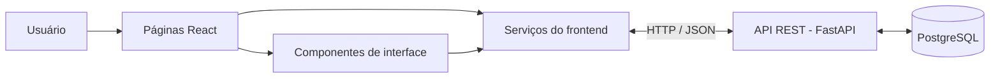
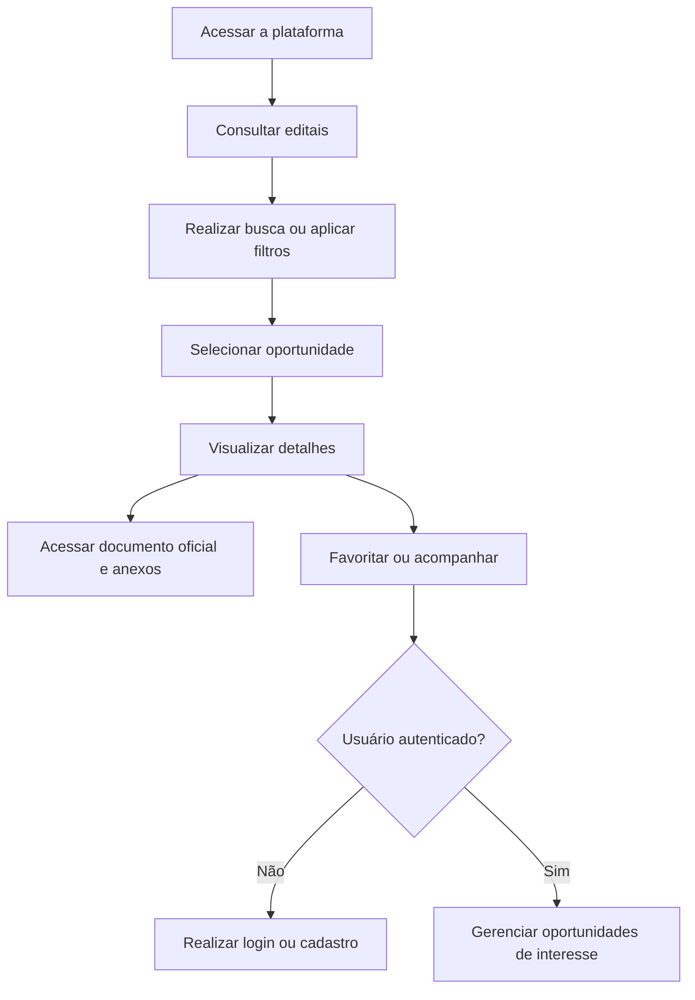
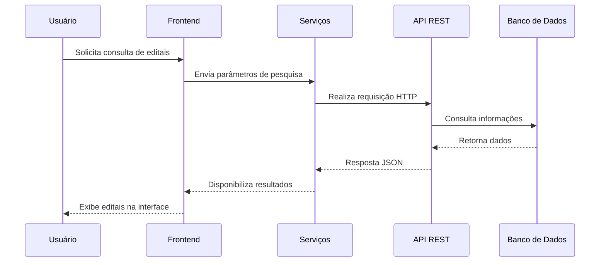

# Frontend

## Visão geral

O frontend do Fique de Olho é a interface web do projeto desenvolvido pelo grupo G4 da disciplina de Métodos de Desenvolvimento de Software (UnB 2026/2). Seu objetivo é facilitar a descoberta e o acompanhamento de oportunidades acadêmicas da Universidade de Brasília, reunindo editais de diferentes fontes institucionais em um único ambiente.

A aplicação permite consultar oportunidades, combinar filtros, visualizar detalhes e documentos oficiais, acessar uma conta e acompanhar editais de interesse por meio de favoritos e alertas.

A interface consome a API REST do backend, não realizando diretamente a coleta dos editais nem o acesso ao banco de dados.

- **Aplicação:** [Fique de Olho](https://fique-de-olho.vercel.app/)
- **Código-fonte:** [GitHub](https://github.com/unb-mds/Fique-de-Olho)
- **Documentação da API:** [Swagger](https://fique-de-olho-api.onrender.com/docs)

## Stack

| Tecnologia | Responsabilidade |
| --- | --- |
| React 18 | Construção de telas e componentes reutilizáveis. |
| TypeScript | Tipagem de dados, propriedades e serviços. |
| Vite | Ambiente de desenvolvimento e geração do build. |
| React Router 6 | Navegação entre páginas e proteção de rotas. |
| CSS | Estilização e responsividade da interface. |
| ESLint | Análise estática do código. |
| Prettier | Padronização da formatação. |
| Vitest | Execução de testes automatizados. |
| Testing Library | Testes de componentes e interações. |
| Vercel | Hospedagem e deploy da aplicação. |

A decisão de stack está registrada no [ADR 0002](adr/0002-stack-frontend.md).

## Arquitetura do frontend

A aplicação utiliza o modelo SPA (Single Page Application), com separação entre apresentação, navegação e comunicação com o servidor.



A arquitetura é organizada em três camadas principais:

- **Apresentação:** páginas e componentes responsáveis pela interface e interação com o usuário.
- **Serviços:** comunicação com a API, processamento das respostas e organização dos dados.
- **Navegação:** gerenciamento das rotas públicas e protegidas da aplicação.

O backend é responsável pelas regras de negócio, autenticação e persistência dos dados.

## Estrutura principal

A estrutura abaixo apresenta os principais módulos do frontend, sem listar todos os arquivos do diretório.

```text
Front/
├── package.json
├── README.md
├── vercel.json
└── src/
    ├── components/
    │   ├── Header.tsx
    │   ├── Hero.tsx
    │   ├── FilterBar.tsx
    │   ├── EditalCard.tsx
    │   ├── FavoriteButton.tsx
    │   ├── AlertButton.tsx
    │   ├── HelpAndFeedbackButton.tsx
    │   ├── ProtectedRoute.tsx
    │   └── Footer.tsx
    ├── pages/
    │   ├── HomePage.tsx
    │   ├── EditalDetailPage.tsx
    │   ├── LoginPage.tsx
    │   ├── RegisterPage.tsx
    │   ├── FavoritesPage.tsx
    │   └── NotFoundPage.tsx
    ├── routes/
    │   └── AppRoutes.tsx
    ├── services/
    │   ├── editaisService.ts
    │   └── types.ts
    ├── test/
    ├── utils/
    ├── App.tsx
    ├── main.tsx
    └── index.css
```

### Responsabilidade dos diretórios

| Diretório | Descrição |
| --- | --- |
| components/ | Componentes reutilizáveis da interface. |
| pages/ | Páginas principais da aplicação. |
| routes/ | Configuração das rotas e navegação. |
| services/ | Comunicação HTTP com a API. |
| utils/ | Funções auxiliares e formatação de dados. |
| test/ | Configuração dos testes. |
| App.tsx | Composição principal da aplicação. |
| main.tsx | Ponto de entrada do React. |
| index.css | Estilos globais da aplicação. |

## Páginas e rotas

| Rota | Página | Acesso | Finalidade |
| --- | --- | --- | --- |
| `/` | HomePage | Público | Consultar, buscar e filtrar editais. |
| `/editais/:id` | EditalDetailPage | Público | Visualizar informações detalhadas de um edital. |
| `/login` | LoginPage | Público | Realizar autenticação. |
| `/register` | RegisterPage | Público | Criar uma conta. |
| `/favoritos` | FavoritesPage | Autenticado | Consultar editais favoritados. |
| `*` | NotFoundPage | Público | Informar que a página não existe. |

As rotas são definidas no arquivo `Front/src/routes/AppRoutes.tsx`.

O componente `ProtectedRoute` restringe o acesso às páginas que necessitam de autenticação.

## Componentes da interface

| Componente | Responsabilidade |
| --- | --- |
| Header | Cabeçalho e navegação da aplicação. |
| Hero | Apresentação inicial e destaques. |
| FilterBar | Controles de busca e filtragem. |
| EditalCard | Exibição resumida das oportunidades. |
| FavoriteButton | Favoritar ou desfavoritar editais. |
| AlertButton | Controle de acompanhamento por alertas. |
| HelpAndFeedbackButton | Central de ajuda e feedback. |
| ProtectedRoute | Controle de acesso às rotas protegidas. |
| Footer | Rodapé da aplicação. |

A utilização de componentes reutilizáveis facilita a manutenção, reduz a duplicação de código e contribui para a consistência visual.

## Funcionalidades

### Página inicial

A página inicial é responsável por apresentar as oportunidades acadêmicas disponíveis na plataforma.

Suas principais funcionalidades incluem:

- Apresentação do sistema.
- Destaques de editais com inscrições abertas.
- Listagem de oportunidades.
- Busca textual.
- Filtros de pesquisa.
- Cards de editais.
- Navegação para a página de detalhes.
- Exibição de informações estatísticas.
- Carregamento de novos resultados.

A listagem trabalha com lotes de 12 editais e disponibiliza a opção de carregar mais resultados quando existem oportunidades adicionais.

### Busca e filtros

O sistema permite localizar oportunidades de acordo com diferentes critérios, facilitando a pesquisa e reduzindo o tempo necessário para encontrar editais relevantes.

| Filtro | Finalidade |
| --- | --- |
| Busca textual | Pesquisar oportunidades por palavras-chave. |
| Categoria | Selecionar o tipo de oportunidade. |
| Situação | Filtrar editais abertos ou encerrados. |
| Campus | Selecionar a unidade acadêmica de interesse. |
| Ano | Restringir a pesquisa ao período desejado. |

As categorias documentadas pelo projeto incluem:

- Graduação.
- Pós-graduação.
- Intercâmbio.
- Bolsa.
- Pesquisa.
- Estágio.
- Extensão.
- Evento.
- Vestibular.

A busca textual utiliza debounce para reduzir requisições desnecessárias durante a digitação.

Quando não existem resultados, a interface apresenta uma mensagem informativa e permite limpar os filtros.

### Cards de editais

Os cards são responsáveis por apresentar informações resumidas das oportunidades.

A organização em cards permite que o usuário identifique e compare editais antes de acessar a página completa.

O componente responsável por essa apresentação é o `EditalCard`.

A padronização dos cards contribui para:

- Melhor organização das informações.
- Facilidade de leitura.
- Consistência visual.
- Navegação mais intuitiva.
- Identificação de oportunidades relevantes.

### Página de detalhes do edital

A página `EditalDetailPage` apresenta as informações completas de uma oportunidade selecionada pelo usuário.

A consulta é realizada por meio do identificador do edital presente na rota.

As informações apresentadas, quando disponíveis, incluem:

- Título.
- Descrição.
- Categoria.
- Unidade acadêmica.
- Órgão emissor.
- Data de publicação.
- Data de início das inscrições.
- Prazo final das inscrições.
- Situação do edital.
- Assunto.
- Quantidade de vagas.
- Valor da bolsa ou auxílio.
- Documento oficial.
- Documentos complementares.
- Ações de favoritos e alertas.

A interface depende dos dados retornados pela API. Informações opcionais não fornecidas pelo backend não devem ser interpretadas como valor zero.

### Documentos, anexos e retificações

A página de detalhes permite visualizar os documentos associados a um edital por meio da coleção `documentos` retornada pelo backend.

Entre os documentos que podem ser disponibilizados estão:

- Edital principal.
- Retificações.
- Cronogramas.
- Resultados.
- Formulários.
- Modelos de inscrição.
- Documentos complementares.

Cada documento secundário com URL válida possui um link individual para acesso.

Caso não existam documentos secundários válidos, a interface apresenta uma mensagem informativa.

Os links externos são abertos em uma nova aba utilizando `rel="noopener noreferrer"`.

O documento oficial permanece como referência para confirmação dos requisitos, regras e prazos da oportunidade.

### Cadastro e autenticação

As páginas de cadastro e login permitem que os usuários acessem as funcionalidades pessoais da plataforma.

O projeto prevê autenticação por e-mail e senha e integração com Google OAuth2, conforme a documentação do backend.

A autenticação permite acessar funcionalidades que dependem da identificação do usuário.

A validação das credenciais, das permissões e das sessões é responsabilidade do backend.

A proteção de rotas no frontend não substitui os mecanismos de autorização da API.

### Favoritos

A funcionalidade de favoritos permite reunir oportunidades de interesse em uma área pessoal.

O usuário autenticado pode:

- Favoritar oportunidades.
- Consultar editais salvos.
- Remover editais dos favoritos.
- Acessar novamente oportunidades de interesse.

A página de favoritos está disponível na rota `/favoritos`.

O componente `FavoriteButton` é responsável pela interação de favoritar ou desfavoritar oportunidades.

### Alertas e notificações

A interface disponibiliza uma ação de acompanhamento de editais por meio do componente `AlertButton`.

O envio das notificações por e-mail e o agendamento dos avisos são realizados pelo backend.

Os alertas auxiliam o acompanhamento das oportunidades e dos prazos de inscrição.

Favoritar um edital e habilitar alertas são funcionalidades distintas.

### Central de ajuda e feedback

O componente `HelpAndFeedbackButton` disponibiliza acesso à central de ajuda e ao canal de feedback da aplicação.

Essa funcionalidade contribui para a comunicação com os usuários e a identificação de dificuldades durante a utilização do sistema.

O recebimento e encaminhamento das mensagens são responsabilidades da API.

## Integração com a API

O frontend realiza a comunicação com o backend por meio de requisições HTTP.

O arquivo `editaisService.ts` concentra operações relacionadas à consulta de editais, estatísticas e detalhes.

### Principais endpoints

| Método | Endpoint | Finalidade |
| --- | --- | --- |
| GET | `/api/v1/editais/` | Listagem, busca, filtros e paginação. |
| GET | `/api/v1/editais/stats` | Consulta de estatísticas. |
| GET | `/api/v1/editais/{id}` | Consulta dos detalhes de um edital. |

### Parâmetros de consulta

| Parâmetro | Finalidade |
| --- | --- |
| q | Busca textual. |
| categoria | Filtragem por categoria. |
| status | Filtragem por situação. |
| campus | Filtragem por campus. |
| ano | Filtragem por ano. |
| skip | Deslocamento da paginação. |
| limit | Limite de resultados. |

O serviço utiliza cache em memória com validade de dois minutos para listagem, detalhes e estatísticas, além de reaproveitar determinadas requisições em andamento.

O cancelamento de requisições pode ser utilizado durante alterações na consulta.

Para informações sobre autenticação, favoritos, alertas e feedback, consulte a [Referência da API REST](backend/api.md).

## Jornada do usuário

O fluxo principal de navegação foi organizado para facilitar a descoberta e o acompanhamento das oportunidades acadêmicas.



### Fluxo principal

1. O usuário acessa a página inicial.
2. A aplicação solicita os editais à API.
3. O serviço realiza as requisições HTTP.
4. A interface apresenta os resultados em cards.
5. O usuário utiliza a busca ou os filtros.
6. O usuário seleciona uma oportunidade.
7. A página de detalhes apresenta os dados do edital.
8. O usuário consulta os documentos oficiais.
9. O usuário pode acessar sua conta para utilizar funcionalidades pessoais.

## Jornada dos dados

O fluxo de dados representa a comunicação entre a interface, os serviços e o backend.



O frontend não acessa diretamente o banco de dados. Toda comunicação ocorre por meio da API disponibilizada pelo backend.

## Estados da interface e tratamento de erros

A aplicação apresenta diferentes estados para informar ao usuário o andamento das operações.

| Estado | Comportamento |
| --- | --- |
| Carregamento | Apresenta indicadores visuais enquanto aguarda os dados. |
| Sucesso | Exibe os resultados recebidos da API. |
| Sem resultados | Informa que não existem resultados para os filtros aplicados. |
| Erro de conexão | Apresenta mensagem de erro e opção de tentar novamente. |
| Carregar mais | Indica a solicitação de novos resultados. |
| Falha na paginação | Permite repetir a tentativa de carregamento. |
| Edital não encontrado | Informa que a oportunidade não foi localizada. |
| Ausência de anexos | Informa que não existem documentos secundários disponíveis. |

O tratamento desses estados contribui para uma experiência mais clara, evitando que problemas de comunicação sejam confundidos com ausência de oportunidades.

## Design e experiência do usuário

O frontend busca proporcionar uma interface intuitiva, organizada e acessível aos estudantes da Universidade de Brasília.

Os principais objetivos de design são:

- Facilitar a localização de editais.
- Reduzir o tempo de pesquisa.
- Organizar as informações relevantes.
- Melhorar a navegação entre páginas.
- Manter a consistência visual.
- Facilitar o acompanhamento de oportunidades.
- Reduzir a complexidade da interação com o sistema.

### Responsividade

A aplicação utiliza CSS responsivo para adaptar a interface a diferentes tamanhos de tela.

A validação da responsividade deve considerar:

- Computadores.
- Notebooks.
- Tablets.
- Smartphones.
- Diferentes resoluções de tela.

### Acessibilidade

Como critérios de revisão da interface, recomenda-se verificar:

- Contraste entre textos e fundos.
- Legibilidade das informações.
- Navegação por teclado.
- Identificação dos botões.
- Clareza das mensagens de erro.
- Organização dos elementos visuais.
- Facilidade de interação em dispositivos móveis.

Esses critérios representam recomendações de validação, não uma certificação de conformidade com WCAG.

## Wireframe e protótipo de alta fidelidade

O planejamento visual do frontend utiliza materiais de design para representar a estrutura, a navegação e a experiência do usuário.

O wireframe auxilia na definição inicial da organização dos elementos e das funcionalidades.

O protótipo de alta fidelidade representa uma proposta visual mais próxima da interface final, permitindo analisar a navegação, a identidade visual e a disposição das informações.

Os materiais de design podem ser consultados em:

- [Wireframe](Requisitos/Wireframe.md)
- [Protótipo de alta fidelidade](Requisitos/Prot%C3%B3tipo%20de%20altafidelidade.md)

## Execução local

### Pré-requisitos

- Git.
- Node.js.
- npm.
- Backend acessível localmente ou por uma URL configurada.

O README do frontend indica Node.js 18 ou superior. Recomenda-se utilizar uma versão LTS ainda suportada e compatível com as dependências do projeto.

### Instalação das dependências

A partir da raiz do repositório, execute:

```bash
cd Front
npm ci
```

### Inicialização do frontend

```bash
npm run dev
```

A aplicação estará disponível, normalmente, em:

```text
http://localhost:5173
```

Caso a porta esteja ocupada, consulte o endereço informado pelo Vite no terminal.

### Configuração da API

Na pasta `Front`, configure um arquivo `.env` quando for necessário apontar para a API local.

```dotenv
VITE_API_BASE_URL=http://localhost:8000
```

Após modificar a variável de ambiente, reinicie o servidor de desenvolvimento.

O backend deve estar acessível para que o frontend consiga consultar os editais.

Variáveis com prefixo `VITE_` podem ser expostas no código entregue ao navegador e não devem conter credenciais ou chaves privadas.

### Execução com Docker

Para executar os serviços em conjunto, utilize, a partir da raiz do repositório:

```bash
docker compose up --build -d
```

Para mais informações, consulte a documentação de [Visão Geral e Quickstart do Backend](backend/index.md).

## Testes e validação

A validação do frontend é importante para identificar erros, verificar o funcionamento das funcionalidades e manter a qualidade do código.

### Comandos disponíveis

| Comando | Finalidade |
| --- | --- |
| `npm run dev` | Inicializar o ambiente de desenvolvimento. |
| `npm run build` | Compilar e gerar o build de produção. |
| `npm run preview` | Visualizar o build localmente. |
| `npm run test` | Executar os testes automatizados. |
| `npm run test:watch` | Executar testes em modo interativo. |
| `npm run lint` | Verificar padrões e erros de código. |
| `npm run format` | Aplicar a formatação do código. |

Antes de abrir um Pull Request com alterações no frontend, recomenda-se executar:

```bash
npm run lint
npm run test
npm run build
```

### Validação manual

A tabela abaixo apresenta cenários recomendados para validação. Não representa testes já executados ou aprovados.

| Cenário | Resultado esperado |
| --- | --- |
| Acessar a página inicial | Listagem ou estado informativo é exibido. |
| Aplicar filtros | Resultados correspondentes aos critérios. |
| Realizar busca textual | Exibição dos resultados relacionados. |
| Buscar termo inexistente | Mensagem de ausência de resultados. |
| Carregar mais editais | Novas oportunidades são apresentadas. |
| Abrir página de detalhes | Informações correspondentes ao edital. |
| Consultar anexos | Links individuais para documentos válidos. |
| Abrir edital sem anexos | Exibição de mensagem informativa. |
| Realizar login ou cadastro | Tratamento adequado dos dados fornecidos. |
| Acessar favoritos sem autenticação | Restrição de acesso. |
| Favoritar e desfavoritar | Atualização da lista de favoritos. |
| Habilitar ou desabilitar alertas | Interface reflete a resposta do servidor. |
| Simular falha de conexão | Mensagem de erro e opção de recuperação. |
| Acessar por dispositivo móvel | Conteúdo e controles permanecem utilizáveis. |

## Hospedagem e Deploy

A aplicação web é hospedada na Vercel, com integração ao repositório GitHub.

| Configuração | Descrição |
| --- | --- |
| Plataforma | Vercel. |
| Framework | React com Vite. |
| Diretório raiz | Front. |
| Branch de produção | main. |
| Backend em produção | Render. |
| Banco de dados | PostgreSQL na Neon. |
| Variável de ambiente | VITE_API_BASE_URL. |
| Roteamento | Rewrites configurados no vercel.json. |

### Deploy contínuo

A configuração documentada prevê:

- Deploy automático a partir da branch `main`.
- Previews de deploy para Pull Requests.
- Integração com a API hospedada no Render.
- Roteamento SPA direcionado ao `index.html`.

A aplicação pode ser acessada em:

[https://fique-de-olho.vercel.app/](https://fique-de-olho.vercel.app/)

Para mais informações, consulte o [ADR 0004 — Plataformas de hospedagem e deploy](adr/0004-plataformas-de-deploy.md).

### Publicação da documentação

A documentação técnica do projeto utiliza Material for MkDocs e é publicada por meio do GitHub Pages.

O arquivo `docs/front.md` corresponde à seção Frontend, definida no arquivo `mkdocs.yml`.

As alterações na documentação devem seguir o fluxo de revisão e integração adotado pela equipe.

## Evidências das funcionalidades

Para acompanhar a evolução do frontend, recomenda-se registrar capturas reais das seguintes funcionalidades:

- Página inicial.
- Listagem de editais.
- Busca textual.
- Filtros de pesquisa.
- Cards de oportunidades.
- Página de detalhes.
- Documentos e anexos.
- Tela de login.
- Tela de cadastro.
- Área de favoritos.
- Controle de alertas.
- Central de ajuda.
- Responsividade em dispositivos móveis.

As imagens poderão ser armazenadas no diretório `docs/assets/frontend/`.

As capturas devem representar a versão real da aplicação, sem exposição de dados pessoais ou credenciais.

Sempre que possível, deve-se registrar a data e a versão ou commit utilizado.

## Manutenção e contribuição

A manutenção do frontend deve seguir os padrões de organização e desenvolvimento adotados pela equipe.

Recomendações:

- Utilizar componentes reutilizáveis.
- Manter a organização dos diretórios.
- Evitar duplicação de código.
- Atualizar a documentação após novas implementações.
- Verificar a integração com o backend.
- Validar a responsividade.
- Executar os testes necessários.
- Utilizar branches separadas.
- Registrar alterações por meio de commits.
- Submeter alterações para revisão por Pull Request.

## Referências

- [Repositório do projeto](https://github.com/unb-mds/Fique-de-Olho)
- [Aplicação em produção](https://fique-de-olho.vercel.app/)
- [Documentação da API](https://fique-de-olho-api.onrender.com/docs)
- [README do frontend](https://github.com/unb-mds/Fique-de-Olho/blob/main/Front/README.md)
- [Dependências e scripts](https://github.com/unb-mds/Fique-de-Olho/blob/main/Front/package.json)
- [Rotas da aplicação](https://github.com/unb-mds/Fique-de-Olho/blob/main/Front/src/routes/AppRoutes.tsx)
- [Página inicial](https://github.com/unb-mds/Fique-de-Olho/blob/main/Front/src/pages/HomePage.tsx)
- [Página de detalhes](https://github.com/unb-mds/Fique-de-Olho/blob/main/Front/src/pages/EditalDetailPage.tsx)
- [Serviço de editais](https://github.com/unb-mds/Fique-de-Olho/blob/main/Front/src/services/editaisService.ts)
- [Configuração do MkDocs](https://github.com/unb-mds/Fique-de-Olho/blob/main/mkdocs.yml)
